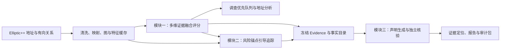

# 链境智安 · 系统说明

**基于多维证据融合的链上反洗钱与可解释研判系统**

系统以“地址风险评分—资金关系追踪—可解释报告”为主线，在同一工作台中完成重点地址发现、关联路径展开和研判材料导出。新版界面由宣传首页与独立分析工作台组成，使用 HTML/CSS/JavaScript、FastAPI 和 Python 算法服务。

## 打开与演示

首次部署见 [下载与启动](GITHUB_运行说明.md)，完整讲解见 [比赛演示指南](docs/DEMO_GUIDE.md)。

```bash
python run_web.py
```

访问 **http://127.0.0.1:8000/**，点击“开始分析”。Windows 可运行 `run_web.ps1` 或 `run_demo.ps1`；macOS 可在配置好 Python 环境后双击 `启动新版前端.command`。

| 页面 | 主要操作 | 展示结果 |
|---|---|---|
| 宣传首页 | 浏览项目背景、技术路径与证据融合 | 项目价值、三项核心技术与报告样张 |
| 调查优先队列 | 风险排序、分页、选择地址、下载 CSV | 优先核查对象与风险分布 |
| 地址风险分析 | 输入地址/节点 ID，或点击快捷示例 | 综合分、三类诊断、TreeSHAP 贡献与特征表 |
| 关系链追踪 | 选择快速/长链模式，运行追踪 | 可拖动网络、逐跳风险、连接见证、路径 JSON |
| AI分析报告 | 生成报告、选择证据编号、导出材料 | 六段报告、声明核验、Evidence JSON 与审计 ZIP |


## 架构与模块衔接



**模块一：多维证据融合风险评分。** 51 维行为画像刻画地址自身，102 维方向邻域偏离比较地址与上下游差异，18 维有向结构角色描述汇入、分出及两步连接。171 维特征输入同一个 LightGBM，校准后输出 0–100 风险分。TreeSHAP 分解联合模型的实际决策，三类诊断与归因同屏呈现。见 [模块一设计](docs/MODULE_01_ADDRESS_RISK_SCORING.md)。

**模块二：风险锚点引导的关系追踪。** 模块一的全量风险表为追踪提供锚点；反向可达索引为前向搜索提供连接见证，预算约束控制扩展规模，覆盖选路和前缀折叠提高结果的信息密度。支持默认 4 跳快速筛查和最长 32 跳长链核查。见 [模块二设计](docs/MODULE_02_RELATION_TRACING.md)。

**模块三：证据约束的可解释报告。** 将评分、归因和路径冻结为 Evidence，建立带类型与来源的事实目录；大模型组织声明，程序回填事实并核验类型、主体、单位和位置。局部修复与确定性模板保障报告交付，点击证据编号即可定位依据。见 [模块三设计](docs/MODULE_03_EXPLAINABLE_REPORT.md)。

## 实验结果

数据包含 822,942 个地址、2,784,344 条清洗后的有向关系。已知标签按时间划分，训练/验证/测试地址数分别为 170,404 / 38,514 / 56,436；未知标签参与图建模与查询。

| 已知标签测试集风险评分 | 结果 |
|---|---:|
| Top-100 命中 | 100/100 |
| Top-500 命中 | 488/500（97.60%） |
| Top-1% 命中 | 545/565（96.46%） |
| Precision | 86.65% |
| ROC-AUC | 0.8804 |

关系追踪在同一组 72 个评估起点上，相比原 Beam，累计预测锚点从 5 增至 23，唯一关系边从 5 增至 59；3 个精选长链案例均达到 32 跳，路径方向与各条原始关系逐一核对。

报告协议在 120 个人为故障测试中全部拦截错误声明，12 个正确用例通过；120 次模拟局部修复保留了 1,200 条已通过声明。已有真实 DeepSeek 接口报告完成声明核验；新前端支持证据定位、核验记录及一键审计导出。

实验样本与复现入口见 [测试与评估](docs/EVALUATION_PROTOCOL.md)，三项创新与痛点的对应见 [创新说明](docs/THREE_MODULE_INNOVATION_ALIGNMENT.md)。

## 运行与大模型配置

推荐 Python 3.11、16 GB 内存，当前联合模型支持 CPU 演示。网页依赖安装命令为 `python -m pip install -r requirements-web.txt`；浏览器图表库已随项目提供。

复制 `.env.example` 为 `.env`，填写服务商的 API Key 与模型名并重启服务，即可选择“自动选择报告来源”。也可以直接选择“结构化证据模板”体验完整的证据、报告与下载流程。新版网页的报告输出上限默认 32768 token，超时 90 秒，可通过 `LLM_MAX_TOKENS` 与 `LLM_TIMEOUT_SECONDS` 调整。密钥由 Python 服务端读取。

## 验证与复现

```bash
python scripts/prepare_runtime_data.py
python scripts/34_check_runtime.py
python -m pip install pytest httpx
python -m pytest tests/test_web_api.py tests/test_web_reporting.py tests/test_audited_reporting.py tests/test_runtime_data.py -q
```

浏览器回归脚本 `scripts/check_web_ui.cjs` 和 `scripts/check_network_ui.cjs` 覆盖四模块联动、关系网络与移动端交互，使用 Playwright；详见 [网页维护](README_WEB.md)。训练与预计算入口见 [评分实现与复现](docs/RISK_SCORING_REDESIGN.md)。

保留的 `app.py` 提供 Streamlit 辅助入口（`python -m streamlit run app.py`，默认 8501）；评审演示以新版网页工作台为主。文件导航见 [目录说明](docs/DIRECTORY_GUIDE.md)。

## 数据与技术来源

- Elliptic++：Elmougy & Liu, KDD 2023，[论文](https://doi.org/10.1145/3580305.3599803)。
- LightGBM：Ke et al., NeurIPS 2017，[论文](https://proceedings.neurips.cc/paper/2017/hash/6449f44a102fde848669bdd9eb6b76fa-Abstract.html)。
- TreeSHAP：Lundberg et al., Nature Machine Intelligence 2020，[论文](https://doi.org/10.1038/s42256-019-0138-9)。

当前围绕公开地址关系数据完成风险研判；实时数据接入、跨链关联与金额级归因是后续扩展方向。
