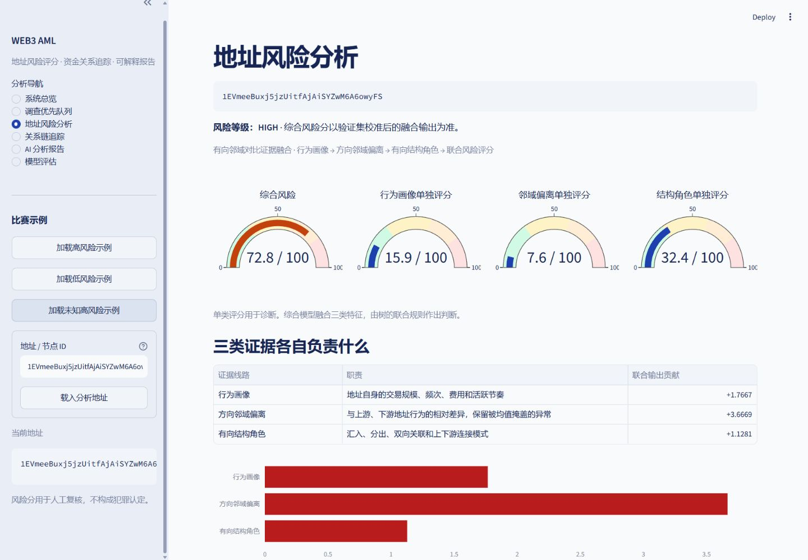

# Web3 轻量化反洗钱智能分析系统

基于 Elliptic++ Actors 公开数据，实现 **地址风险评分 → 有向关系链追踪 → 结构化证据 → 可解释报告 → Web 演示**。

当前 V2.0 主线是三个功能：**地址风险评分、资金关系追踪、可解释报告**。
评分采用“有向邻域对比证据融合”：行为画像 51 维、上下游相对偏离 102 维、有向结构角色 18 维，交给一个联合 LightGBM；Native TreeSHAP 解释实际综合决策。
测试 AP **0.5429**、F1 **0.5520**、Recall **0.4050**。去掉三类证据或边方向均有下降。
设计、顶会方法参考、四轮实验与严格消融见 [重构说明](docs/RISK_SCORING_REDESIGN.md)。旧神经 / 调查模型仅作为历史对照保留。

第一个模块的完整实现清单、四个模型分工与当前验收结果见 [地址风险评分模块记录](docs/MODULE_01_ADDRESS_RISK_SCORING.md)；图解见 [结构流程图](docs/RISK_SCORING_FLOWCHART.md)。

研发遵循 [三个模块—痛点—创新对应](docs/THREE_MODULE_INNOVATION_ALIGNMENT.md)。第二模块已接入风险锚点可达见证、预算化桥接与覆盖选路；实现、接口、19 组对照和复现见 [资金关系追踪记录](docs/MODULE_02_RELATION_TRACING.md)。PPR 保留为对照，当前默认关闭。
2026-10-12新增可选32跳长链关联核查和逐跳证据视图，默认仍4跳快速筛查。真实精选长链与重复样本实验分别记录，见[模块二比赛亮点](docs/MODULE_02_COMPETITION_HIGHLIGHTS.md)。
模块三已实现[证据类型约束的可审计解释报告](docs/MODULE_03_EXPLAINABLE_REPORT.md)：六段声明JSON、类型/主体/单位核验、有限局部修复、点击证据定位、原始CSV来源索引与审计包。120个人为故障中，旧引用校验拒绝24个，新协议拒绝120个；10个真实Evidence案例通过（含32跳）。DeepSeek官方API已完成首次真实验收：同一地址命令行和网页各生成一次，均52条声明首轮通过，无修复或模板回退。详见[连接验收](docs/DEEPSEEK_CONNECTION.md)；故障实验不代表自然生成幻觉率。

## 快速打开已准备的演示

在本目录运行：

```powershell
.\run_demo.ps1
```

打开 **http://127.0.0.1:8501**。左侧加载示例，依次查看地址风险、关系链追踪、AI 报告和模型评估。
也可从“调查优先队列”选候选，再进入地址证据、路径和报告。
页面显示真实数据范围。详细流程见 [比赛演示指南](docs/DEMO_GUIDE.md)。



当前截图：[真实路径追踪](docs/screenshots/tracing_v2_desktop.png)、[低分连接见证](docs/screenshots/tracing_v2_witness.png)。`evidence_tracing.jpg` 为旧 Beam 记录。
模块三截图：[报告与原CSV来源定位](docs/screenshots/reporting_v3_source.png)、[错误拦截与模拟局部修复](docs/screenshots/reporting_v3_fault_demo.png)。
`overview.png`、`address_risk.png`、`tracing.png` 与 `investigation_*.jpg` 保留为历史版本记录。

## 环境与安装

- Python 3.10 / 3.11，当前验证环境使用 Python 3.11。
- 全量预处理建议至少 16GB 内存。CPU 可以运行；有兼容 NVIDIA GPU 时可以使用 CUDA 12.1 的 Torch 构建。
- 默认 GraphSAGE batch size 256、邻居采样 `[15, 10]`。内存 / 显存不足时修改 `config/model.yaml`。
- Windows 项目虚拟环境位于当前目录 `.venv/` 或比赛根目录 `.venv/`，启动脚本自动识别。

```powershell
# 无需激活虚拟环境，安装脚本会使用独立环境
.\setup.ps1

# 若需要切换到 CUDA 12.1（会下载更大的 Torch 包）
.\setup.ps1 -TorchBuild cu121
```

PyG 的 `NeighborLoader` 需要编译采样后端，`setup.ps1` 会安装与 Torch 2.5.1 匹配的 `pyg_lib`。
如果手工安装，请使用对应构建的官方 wheel，不要在 Windows 上默认编译源码：

```powershell
python -m pip install -r requirements.txt
python -m pip install pyg_lib --no-index -f https://data.pyg.org/whl/torch-2.5.1+cpu.html
```

`requirements-lock.txt` 记录已验证的本机 CPU 包版本。通过对应的 PyTorch / PyG wheel 源才能安装带 `+cpu` / `+pt25cpu` 的锁定版本。

## 数据来源与准备

官方仓库：[git-disl/EllipticPlusPlus](https://github.com/git-disl/EllipticPlusPlus)。
三份 CSV 是 Git LFS 对象。下载脚本直接下载官方媒体对象，并检查 LFS SHA-256 和字节数：

```powershell
python scripts/00_download_data.py
python scripts/01_inspect_data.py
```

默认文件放在 `data/raw/`：

| 文件 | 用途 | 已确认的关键列 |
|---|---|---|
| `wallets_features.csv` | 地址特征与时间步 | `address`、`Time step` |
| `wallets_classes.csv` | 地址标签 | `address`、`class` |
| `AddrAddr_edgelist.csv` | 有向地址关系 | `input_address`、`output_address` |

官方原始数据：822,942 个地址、1,268,260 行时间步特征、2,868,964 行关系边。
原始标签编码是 `1 = illicit`、`2 = licit`、`3 = unknown`，内部统一为 `1 / 0 / -1`。
输入字段差异只修改 `config/data.yaml`。

## 离线训练与评估

如果尚未激活虚拟环境，本机可以把下方 `python` 替换为 `..\.venv\Scripts\python.exe`。
脚本相对路径按本项目目录执行；源码不依赖调用时的 `PYTHONPATH`。

以下为历史 V1 基础流程；当前 V2 部署见后方“当前评分复现”。运行此流程会生成旧评分。

可执行带阶段测试的 V1 全量流程：

```powershell
.\scripts\run_pipeline.ps1
# 已有校验过的 CSV 时：.\scripts\run_pipeline.ps1 -SkipDownload
# 子图试运行：.\scripts\run_pipeline.ps1 -MaxNodes 40000 -Epochs 20
```

```powershell
python scripts/02_preprocess.py
python scripts/03_train_baseline.py
python scripts/04_train_dual_view.py
python scripts/05_evaluate.py
python scripts/06_precompute_scores.py
python scripts/07_build_demo_cases.py
python scripts/08_validate_demo.py
python -m pytest -q
python -m streamlit run app.py
```

`04_train_dual_view.py` 默认依次训练三个神经网络版本（独立 MLP、独立 GraphSAGE、Dual-View），按验证 PR-AUC 早停，轮数由 `config/model.yaml` 设置（当前最多 35 轮）。
综合分在验证集做温度校准，分类阈值在验证集选择；测试集不直接用于参数选择；该公开基准已被此前版本查看，属于重复评估。

可选的快速工程试运行：

```powershell
python scripts/02_preprocess.py --max-nodes 40000
python scripts/03_train_baseline.py
python scripts/04_train_dual_view.py --epochs 20
# 然后依次执行 05–08
```

该模式使用真实数据诱导子图，UI 和所有指标文件均标记 `real_data_pilot`。
重新切换数据范围后必须重新训练、预计算和生成案例；系统用数据指纹阻止模型与数据混用。

## 模块与目录

双线路风险评分的独立优化实验见 [优化协议](docs/RISK_OPTIMIZATION_PROTOCOL.md)。
按原训练区间内的两个时间划分开发，冻结方案后做三个种子的最终对比与固定融合消融：

```powershell
python scripts/09_diagnose_risk_model.py
python scripts/10_optimize_risk_model.py --stage development
python scripts/10_optimize_risk_model.py --stage final
python scripts/11_summarize_risk_experiments.py
```

结果保存在 `artifacts/experiments/risk_v2/`；这只是实验编号，仍沿用 V1 的轻量化架构。
本轮已完成 37 次实验。结果见 [优化报告](artifacts/experiments/risk_v2/REPORT.md)，包含三个种子的均值、标准差、固定融合消融和人工复核预算对比。
`12_promote_risk_model.py` 仅允许达到预先规定 AP/F1 门槛的冻结模型安装，并备份现有 Demo。
安装后需重新运行 06～08、验收并重启页面服务。实验选择不依赖新测试结果。
要精确复现本轮按验证 AP 选择的代表模型和对比表，请使用 10～12 的实验流程；普通训练入口使用主配置的单个种子，不复现多种子选择。

详见 [目录导航](docs/DIRECTORY_GUIDE.md)。

```text
config/         数据适配、模型、搜索、特征名称、LLM 配置
src/data/       检查、清洗、节点映射、划分、图构建
src/model/      当前有向偏离 / 结构；历史神经模型和校准
src/train/      采样训练、测试指标与曲线
src/baseline/   LightGBM
src/inference/  离线评分、在线查表、分析服务
src/explain/    图风险统计、历史行为 IG
src/tracing/    原始有向图、Beam Search
src/report/     Evidence JSON、LLM 报告、模板回退
src/ui/         六个独立页面；app.py 只负责入口和导航
scripts/        按执行顺序编号的流水线
data/           原始 CSV 与可复用的预处理结果
artifacts/      模型、指标、风险表、路径、证据和报告
tests/          核心算法、数据边界、报告回退和 UI 验证
logs/           各阶段日志
```

## 当前评分复现与解释

当前缓存已准备，直接启动即可。完整四轮试验的前置依赖和 16–22 复现步骤见 [重构说明](docs/RISK_SCORING_REDESIGN.md)。
安装已训练的当前模型并重建案例：

```powershell
python scripts/21_precompute_evidence_scores.py
python scripts/22_report_risk_redesign.py
python scripts/07_build_demo_cases.py
python scripts/08_validate_demo.py
python -m pytest -q
```

- 行为画像看地址自身，邻域偏离分别比较上下游，结构角色保留方向和两步关系。
- 171 维联合特征交给一个树模型；三组单类分只是诊断，不做概率平均。
- 加权赔率校正、验证温度校准后输出 0–100 综合分，等级边界 30 / 60 / 80。
- 联合 TreeSHAP 按三组求和，瀑布图核对原始 margin、类别权重校正与校准后分数。
- 当前 Gate 字段为空，不编造融合权重；历史 MLP / GraphSAGE / Dual-View 可查对照。

## 风险引导追踪

当前沿下游关系进行预算化Beam搜索，默认最大深度4、宽度5、风险锚点门槛30、每节点最多50个邻居、返回Top-10路径，在线关系检查上限2,000。低分节点有通往风险锚点的真实有向见证时，可保留最多3个连续低分连接，原始节点评分保持不变。

基础排序仍综合节点风险、邻域风险与degree惩罚；当前追踪再使用锚点可达见证、预算限制、边覆盖选路与严格前缀折叠，完整参数和路径效用定义见[模块二记录](docs/MODULE_02_RELATION_TRACING.md)。路径排序分不是地址风险概率。
算法执行环路检查、邻居限制和逐层剪枝，返回有向子图、连接见证及搜索边界。可选长链模式支持32跳真实关系核查，默认仍为4跳。
该路径是关系链，不执行精确金额归属或严格时间连续资金追踪。

## LLM 连接与回退

复制 `.env.example` 为 `.env`，填写：

```dotenv
LLM_BASE_URL=https://your-provider.example/v1
LLM_API_KEY=your_key
LLM_MODEL=your_model
```

API 使用 OpenAI-compatible Chat Completions，要求支持 JSON object 输出。密钥不写入源码或日志。
LLM 组织固定六段声明JSON，每条引用程序注册的事实，类型、主体、单位与位置必须匹配；程序从Evidence回填数字、地址与路径，禁止模型自行编写事实自由文本。
局部失败最多请求一次受限修复，保护已通过声明；仍失败时局部模板替换并补全核心事实。未配置API或网络失败时使用同协议确定性模板，页面明确显示来源。
点击E编号定位字段、特征或路径段，可下载原始候选、核验记录、最终声明与文件哈希组成的审计包。页面附带明确标注的故障注入/模拟修复演示。
不自动使用 Codex 会话密钥；在线调用成功需要单独提供可用的项目 API 配置。

### DeepSeek Flash首次连接

本地`.env`已为此次接入准备，Key只在本地填写。官方仍接受`deepseek-v4-flash`旧别名，但目前实际由V4.1 Flash服务，不能固定旧版V4。

```dotenv
LLM_PROVIDER=deepseek
LLM_BASE_URL=https://api.deepseek.com
LLM_API_KEY=在本地填入自己的Key
LLM_MODEL=deepseek-v4-flash
```

`config/llm.yaml`为DeepSeek显式关闭思考模式，并设置8192输出token上限。其他服务商不接收DeepSeek专用参数。
保存后重启演示服务。可以在项目目录先运行小请求检查，再检查一个真实报告案例（会产生少量API费用）：

```powershell
..\.venv\Scripts\python.exe scripts/32_check_llm_connection.py
..\.venv\Scripts\python.exe scripts/32_check_llm_connection.py --report
```

检查脚本不打印密钥或原始异常消息；报告模板回退不算LLM成功。真实结果保存在`artifacts/metrics/llm_connection_acceptance.json`，报告阶段同时记录通过/修复/补全情况和审计包。

## 比赛案例和指标

- `artifacts/demo_cases.json`：至少三个测试 illicit、三个测试 licit、三个 unknown 高风险地址。
- `artifacts/metrics/comparison.csv`：四模型的真实测试对比。
- `artifacts/metrics/*_pr_curve.png`、`*_roc_curve.png`、`*_confusion_matrix.png`：可用于答辩的图。
- `artifacts/metrics/demo_acceptance.json`：数据范围、全量评分数和各案例验收结果。
- `artifacts/reports/`：按地址的报告，以及独立report编号目录中的Evidence、声明、候选、核验记录、Markdown和哈希清单。
- `artifacts/reporting/source_index.json`：当前案例原始CSV定位索引（154个地址记录、139对有向关系）。
- `artifacts/experiments/report_v3_release_stable/`：模块三正式故障对照、模拟修复与真实Evidence验收。

本次真实指标与验收状态见 [PROJECT_STATUS.md](docs/PROJECT_STATUS.md)。

当前主模型测试 AP 0.5429、F1 0.5520、Precision 0.8665、Recall 0.4050。
已知标签测试地址 Top-500 命中 488/500（97.6%），不能称为整体准确率或未知地址真实命中率。
完整模型去行为 AP 0.4799、去邻域偏离 0.2829、去结构 0.5114、去方向 0.3445。
模型为确定性树，一个结果；历史神经模型的多种子均值在比较材料中单独标注。
推荐未知高风险示例展示多跳关系；已知高风险示例可能仅一跳，低风险可无路径。
详细边界见 [评估协议](docs/EVALUATION_PROTOCOL.md)。

## 局限与 V1 范围

生命周期汇总特征不能还原历史时点可见信息，时间划分结果不能宣传为实时早期预测。
数据标签不完整；单类诊断分独立校准仍不保证未知人群校准；二跳在线图证据有采样局限。
V1 不包含实时 RPC、跨链、Swap / Mixer 专项、KYC、真实身份推断、金额级污染追踪或复杂异构模型。

## 数据引用

Youssef Elmougy and Ling Liu. 2023. *Demystifying Fraudulent Transactions and Illicit Nodes in the Bitcoin Network for Financial Forensics.* KDD ’23.
https://doi.org/10.1145/3580305.3599803
