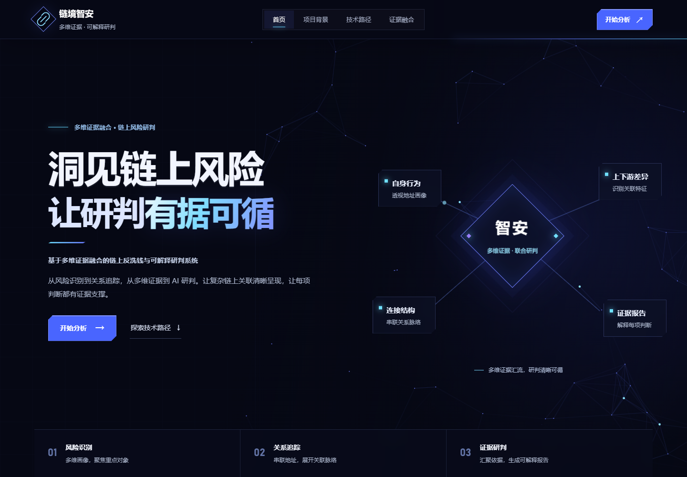

# 链境智安 · 网页工作台

系统采用“宣传首页＋独立工作台”：首页介绍项目价值和技术路径，工作台承载从重点发现到报告交付的完整操作。统一入口为 `python run_web.py`，浏览器访问 **http://127.0.0.1:8000/**。安装步骤见 [下载与启动](GITHUB_运行说明.md)。

## 页面设计

| 页面 | 路径 | 功能 |
|---|---|---|
| 宣传首页 | `/` | 动态首屏、项目背景、技术流程、证据报告样张 |
| 调查优先队列 | `/workspace/queue` | 风险分布、排序候选、分页、CSV 导出 |
| 地址风险分析 | `/workspace/risk` | 地址查询、三组示例、联合评分、TreeSHAP、特征明细 |
| 关系链追踪 | `/workspace/trace` | 快速/长链切换、六项参数、关系网络、逐跳证据、JSON 导出 |
| AI分析报告 | `/workspace/report` | 报告生成、声明定位、核验记录、审计下载、故障与修复演示 |



工作台每次显示一个模块。选择地址会进入风险分析，“继续关系追踪”进入路径页；返回首页再进入工作台，可恢复当前页面内的输入、结果、网络布局与证据选择。关系网络支持拖动节点、平移、缩放、方向键整理、适应视图与重置布局。


## 前后端衔接

FastAPI 同时提供网页资源和分析接口，浏览器通过 HTTP 调用原有 Python 分析服务。评分、追踪和报告分别生成独立编号，并绑定同一地址、数据和模型版本。报告使用已确认的评分与追踪快照，下载材料与页面结果一致。

| 接口 | 用途 |
|---|---|
| `GET /api/meta` | 数据概况、风险统计、示例与追踪默认参数 |
| `GET /api/queue`、`GET /api/queue/export` | 调查队列及 CSV 下载 |
| `GET /api/risk?address=...` | 综合评分、归因与关联证据 |
| `POST /api/traces` | 基于 `analysis_id` 生成追踪 |
| `GET /api/traces/{trace_id}/export` | 原始路径 JSON |
| `POST /api/reports` | 基于 `analysis_id`、`trace_id` 生成报告 |
| `GET /api/reports/{report_id}/export` | Markdown / TXT / Evidence JSON |
| `GET /api/reports/{report_id}/bundle` | 完整审计 ZIP |

## 源码入口

| 修改内容 | 文件 |
|---|---|
| 页面结构 | `frontend/index.html` |
| 布局和样式 | `frontend/styles.css`、`frontend/pages.css`、`frontend/reference.css` |
| 路由与模块联动 | `frontend/js/router.js`、`frontend/js/workspace.js` |
| 队列、评分、追踪、报告 | `frontend/js/views/` |
| 关系网络交互 | `frontend/js/relation-network.js` |
| 模型展示名 | `frontend/js/display-metadata.js` |
| 项目背景内容 | `frontend/content/project-background.json` |
| 接口与分析快照 | `api/main.py`、`api/runtime.py`、`api/store.py` |
| 报告调用参数 | `api/reporting.py` |

修改项目背景 JSON 后运行 `python scripts/render_background.py` 同步静态页面。图表库随项目存放在 `frontend/vendor/`，网页无需 npm 构建。

## 浏览器验证

浏览器验证覆盖四模块联动、返回恢复、下载、32 跳案例及多种屏幕宽度。准备 Playwright 后运行：

```bash
npm install --no-save playwright
npx playwright install chromium
node scripts/check_web_ui.cjs
node scripts/check_network_ui.cjs
```

可通过 `WEB3AML_URL` 指定服务地址，通过 `WEB3AML_CHECK_OUTPUT` 指定检查输出目录。使用现有 Chrome 时设置 `CHROME_PATH`；使用独立 Playwright 安装时设置 `PLAYWRIGHT_MODULE`。验证生成的截图、下载与日志保存在 `artifacts/` 下对应检查目录。

当前网页展示以三个核心算法模块为主，模型评估数据集中在仓库实验说明中。Streamlit 辅助界面保留在 `app.py` 与 `src/ui/`。

Plotly.js、Cytoscape.js 的版本与许可证保留在 `frontend/vendor/`；页面采用系统字体和本地静态资源。
