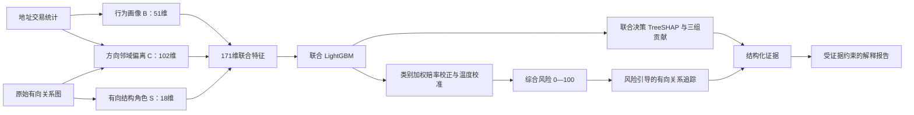

# 地址风险评分重构：设计、实验与比赛讲解

更新：2026-10-11。**当前主模型已切换为 V2.0“有向邻域对比证据融合”。**

当前实现清单与模型分工见 [模块一实现记录](MODULE_01_ADDRESS_RISK_SCORING.md)，结构图见 [评分流程图](RISK_SCORING_FLOWCHART.md)。

项目主线始终是三个功能：**地址风险评分 → 资金关系追踪 → 可解释报告**。
本文只优化第一个功能，并说明它如何把评分与证据交给后两个功能。

## 1. 最终选择与命名

采用 **三路证据、联合特征决策**：

1. 行为画像：地址自己呈现什么交易模式。
2. 方向邻域偏离：地址与上游、下游地址相比，有什么相对差异。
3. 有向结构角色：地址处于怎样的汇入、分出、双向关联和二步关系结构中。

三类特征拼接后，由一个联合 LightGBM 输出综合风险。**当前主模型没有 GraphSAGE、MLP，也没有重复的图编码器。**
历史 MLP、GraphSAGE、双线路 Gate 和旧三专家模型作为实验对照保留。

比赛建议称为“方向感知的多视角特征融合评分”或“有向邻域对比证据融合”。
这里的“线路”指三个承担不同任务的特征构建通道；不是三个完全独立的数据源，也不是三个神经网络。
邻域偏离需要拿地址行为和邻居行为作比较，因此会共享原始特征，这是比较操作所需的输入。

当前共训练四个 LightGBM：行为诊断模型（51维）、偏离诊断模型（102维）、结构诊断模型（18维）、联合主模型（171维）。三个诊断模型只给出单类分，联合主模型直接输入全部特征；当前不是三个模型输出融合。三类特征构建阶段分别采用数值处理、邻域均值/标准差比较和有向图统计，没有单独的神经编码器。

## 2. 每条线路负责什么，改善什么

| 线路 | 输入 / 维度 | 负责回答的问题 | 对单类方法的补充 | 可展示的依据 |
|---|---|---|---|---|
| 行为画像 B | 本地址 51 项交易统计 | 这个地址自身的规模、频次、费用和节奏如何？ | 给关系模式提供个体语境，帮助区别相似结构下不同的行为 | 原始特征、对应的联合模型 TreeSHAP |
| 方向邻域偏离 C | 上游 / 下游各 51 项标准化偏离，共 102 项 | 它和两种方向的邻居相比有什么差异？ | 保留均值聚合可能掩盖的异常；区分接收侧和发送侧的关联环境 | 上游 / 下游均值、离散程度、偏离值与 TreeSHAP |
| 有向结构角色 S | 18 项无标签关系统计 | 它是主要汇入、分出还是双向关联？周围节点怎样连接？ | 给相似行为提供关系角色语境，补充拓扑与二步连接模式 | 入出度、方向平衡、双向比例、上下游结构与 TreeSHAP |

“相对差异大”或“汇入多”不直接等于非法。模型学习这些模式与训练标签的关系，报告描述模型依据。
前端同时展示三个**单类证据模型的诊断分数**；综合模型直接读特征，**不平均这些诊断概率**。



## 3. 邻域偏离怎么计算

保留原始边方向 `A → B`。上游是指向目标地址的邻居，下游是目标地址指向的邻居。
先对原始数值特征做 signed log1p、训练集拟合的填补与标准化、±8 裁剪。
去掉四项绝对区块高度字段，保留 51 项输入。

对每个方向 d 和每个特征 f：

```text
μ(v,d,f) = 该方向邻居特征的均值
σ(v,d,f) = 该方向邻居特征的总体标准差
z(v,d,f) = clip((x(v,f) - μ(v,d,f)) / max(σ(v,d,f), 0.5), -8, 8)
```

无该方向邻居时 z 记为零，表示没有对应的相对证据。标准差下限避免少量或完全相同的邻居导致数值爆炸。
重复边合并，自环移除。训练、开发验证和最终验证只使用相应截止时间之前节点之间的关系。

通俗例子：某地址交易规模较大，但它的邻居也普遍是大额活跃地址，则单看“大额”与相对偏离会给出不同语境。
如果本地址和上下游行为明显不同，偏离特征能把这种差异保留下来。这里没有进行真实身份或服务地址识别。

## 4. 有向结构的 18 项特征

前八项：入度对数、出度对数、邻居数量对数、出入方向平衡、双向邻居比例、下游 / 上游平均连接度对数、孤立标志。

新增十项：

- 下游平均入度对数、下游平均出度对数。
- 上游平均入度对数、上游平均出度对数。
- 下游 / 上游平均方向平衡。
- 下游终点比例、上游起点比例。
- 正向 / 反向二步关系游走数量对数，剔除立即回到起点的游走。

这些是地址关系统计，不是金额流量。关系边没有完整交易金额和时间，当前追踪仍然是可疑资金关系链追踪。

## 5. 参考文献与我们实际改了什么

| 参考 | 已核实来源 | 参考的思想 | 本项目实现 | 没有声称复现的部分 |
|---|---|---|---|---|
| Wu 等，Simplifying Graph Convolutional Networks | [ICML 2019 / PMLR](https://proceedings.mlr.press/v97/wu19e.html) | 将图传播预计算，与学习部分分离 | 静态稀疏图算子及离线缓存，支持 CPU 全量推理 | 原 SGC 线性分类器没有作为当前主模型 |
| Tang 等，Rethinking Graph Neural Networks for Anomaly Detection / BWGNN | [ICML 2022 / PMLR](https://proceedings.mlr.press/v162/tang22b.html) | 异常信号可能存在于高频和带通部分 | 实现了 degree-two beta 多频滤波；进一步试验邻域偏离和离散程度 | 当前不是完整 BWGNN；不继承论文性能或理论结论 |
| Gasteiger 等，Predict then Propagate / APPNP | [ICLR 2019，官方 arXiv 记录](https://arxiv.org/abs/1810.05997) | 将预测与传播解耦，保留可调邻域 | 作为解耦方案的参考，最终选择特征传播与相对比较 | 本轮未训练 APPNP，不能把它放进已完成对比表 |
| Frasca 等，SIGN | [arXiv 原文](https://arxiv.org/abs/2004.11198) | 多尺度算子离线预计算，避免逐批采样 | 一 / 二跳、方向保持与无方向传播的轻量特征试验 | 使用树或点式编码器替代原 SIGN 网络 |
| Rossi 等，Edge Directionality Improves Learning on Heterophilic Graphs / Dir-GNN | [arXiv 原文](https://arxiv.org/abs/2305.10498) | 分别处理入边和出边 | 上游 / 下游均值、标准差和偏离分别计算 | 当前没有完整 Dir-GNN 神经网络 |
| Dou 等，CARE-GNN | [CIKM 2020，官方 arXiv 记录](https://arxiv.org/abs/2008.08692) | 邻居关系可能掩盖欺诈，简单聚合并不总有用 | 帮助确定“关联背景与偏离分别检查”的试验方向 | 没有复现强化学习选邻居或 label-aware similarity |

我们的比赛亮点是**方向邻域对比、三类证据的任务分工、可核对的联合模型解释，以及评分—追踪—报告闭环**。
LightGBM、图传播、标准化偏离和 TreeSHAP 都有已有技术基础，不能把轻量复现本身宣称为原创算法。
对本项目改动的收益由下面的真实实验支撑。

文献搜索使用 academic-search 技能、arXiv 官方 API；核心 ICML 会议信息核对了官方 PMLR 页面。
Semantic Scholar 无 key 的请求被限流，未取得引用数，因此没有编造引用计数。
检索原始记录在 `artifacts/experiments/roles_v1/literature/`。

## 6. 实验协议

数据为 Elliptic++ Actors 全量：822,942 个地址、55 项原始数值特征、2,784,344 条有向关系。
已知标签 265,354 个，其中 illicit 14,266 个；unknown 557,588 个，不进入监督损失。

固定划分：train 170,404，validation 38,514，test 56,436。时间截止分别为 34 / 41 / 49。
测试 illicit 2,548 个。数据指纹：

```text
7c6072a04003949ef91a42ff112428766b15f929fcd24be4abb21008d88043b7
```

早期两轮只按原训练区间内部的两个开发段选方案：1–22 / 23–28，1–28 / 29–34。
它们表现出明显的时间段差异：早期开发最优方案不总能在最近验证段和后续测试保持领先。
第四轮在读入本轮候选的测试预测之前，配置了三段验证 AP 权重：**0.2 / 0.2 / 0.6**。
最近验证段用于部署选型，两个早期开发段作为稳定性约束。此协议与前两轮不同，比较时明确记录。

第四轮选择：标准化偏离融合＋compact 树。叶子数 15、L2=2、最小叶样本 40、学习率 0.04，最多 600 轮，验证 AP 早停 15 轮。
选定模型实际使用 101 轮，单次模型 fit 约 6.5 秒；该耗时不含数据读取、图特征构建和缓存写入。
类别采用 balanced weight；先恢复加权赔率，再在验证集做温度校准。温度 0.9169，验证 F1 阈值 0.2795。

**测试集在此前版本已经被查看，本轮是重复基准实验，不是全新盲测。**
本轮配方 / 参数 / 阈值选择没有直接使用测试指标，但连续实验仍可能存在对同一基准的适应，尚需外部数据验证。

## 7. 四轮尝试：没有只保留成功结果

| 轮次 | 尝试 | 结果与决定 | 产物目录 |
|---|---|---|---|
| 第一轮 | 去掉重复图专家；纯 8 / 18 项结构；共享 Head；10 类架构共 100 组开发配置 | “双线路＋18 项纯结构”测试 AP 均值 0.3688；开发选定三路 AP 0.3465，未超过旧组合；不直接采用 | `roles_v1` |
| 第二轮 | 12 种行为、方向扩散、多尺度、邻域差值和 beta 滤波配方；共 132 组单模型 / 组合配置 | 有向一跳邻域树 AP 0.5140，联合有向画像 0.5354；beta 高验证指标没有在后续测试保持，不选波形复杂度作亮点 | `graph_signals_v1` |
| 第三轮 | 6 种单类模型、三路 Gate、三路拼接点式网络；训练只读缓存，不用 GraphSAGE | 开发最优是单线 context；其测试 AP 均值 0.2730。Gate 没有开发优势，未进入最终测试；不宣称自适应融合成功 | `multievidence_v1` |
| 第四轮 | 4 类联合配方 × 3 个树预算，三段验证；另有匹配单类模型 | 验证选择标准化偏离融合，测试 AP 0.5429，F1 0.5520 | `evidence_tree_v1` |
| 严格消融 | 重新训练移除模型，保留同一预算；并将边无向化后重算特征 | 三类证据和方向各有额外收益；不据此重选主模型 | `evidence_tree_v1_ablation` |

第二轮中更高的测试 AP 不能用来替换已经冻结的该轮开发选择。第四轮参数来自自己的验证选择。
完整候选、未采用方案与预测都保留，方便后续审查与复现。

## 8. 效果怎样

| 方法 | AP | F1 | Recall | 汇总口径 |
|---|---:|---:|---:|---|
| Behavior MLP | 0.1841 | 0.2254 | 0.1549 | 历史三种子均值 |
| GraphSAGE | 0.3223 | 0.3341 | 0.2211 | 历史三种子均值 |
| 原双线路 Gate | 0.3089 | 0.3397 | 0.2318 | 历史三种子均值 |
| 旧重复三专家组合 | 0.3642 | 0.3622 | 0.2391 | 历史三个神经专家种子的均值 |
| **当前有向邻域对比融合** | **0.5429** | **0.5520** | **0.4050** | 一个确定性树模型结果 |

同一测试划分上，当前 AP 比旧重复组合高 0.1788，比 GraphSAGE 均值高 0.2207。
当前 Precision 0.8665、ROC-AUC 0.8804、Brier 0.0298。
AP 指 average precision，项目保存字段为 `pr_auc`；不是梯形积分形式的 PR 曲线面积。

当前 compact 树没有随机子采样，42 / 43 / 44 输出完全相同。
这说明本配置是确定性的，**不能把三份相同输出当成三次独立重复验证**。


## 9. 每部分有用吗：严格移除消融

下表全部使用同一划分、compact 树预算、种子 42、早停和校准协议，移除模型重新训练。

| 方法 | AP | F1 | Recall | 相比完整模型的 AP 变化 |
|---|---:|---:|---:|---:|
| **完整三类证据** | **0.5429** | **0.5520** | **0.4050** | — |
| 去掉行为画像 | 0.4799 | 0.4965 | 0.3921 | -0.0630 |
| 去掉方向邻域偏离 | 0.2829 | 0.2825 | 0.1790 | -0.2600 |
| 去掉有向结构角色 | 0.5114 | 0.5263 | 0.3862 | -0.0315 |
| 去掉边方向 | 0.3445 | 0.3331 | 0.2520 | -0.1984 |

方向对照将原边双向化，再重新计算两侧偏离与结构；节点特征、标签、样本和模型预算不变。
这支持“在本数据与本预算下，边方向和三类证据都有额外价值”。不是其他数据集上的普遍最优证明。

单类诊断对照：只有行为 AP 0.2229，只有标准化偏离 AP 0.1879，只有结构 AP 0.3292。
偏离单独表现不强，但加入行为与结构语境后有效，这正是使用**联合特征决策**的依据。
另一个只看方向邻域均值的对照 AP 0.4823；它不是当前偏离线路的同一组输入。

## 10. 有限人工排查预算

| 预算 | 命中已知 illicit | 命中率 | 测试 illicit 召回 |
|---|---:|---:|---:|
| Top-100 | 100 / 100 | 100% | 3.92% |
| Top-500 | 488 / 500 | 97.60% | 19.15% |
| Top-1%（565） | 545 / 565 | 96.46% | 21.39% |
| Top-5%（2,822） | 1,232 / 2,822 | 43.66% | 48.35% |

Top-100 的 100% 是已知标签测试候选的命中率，不是整体准确率，也不是 unknown 的真实精确率。
整体 Recall 仍为 40.50%，说明模型会漏掉一部分非法标签地址。预算排序和全体分类分别报告。

## 11. 怎么解释实际联合评分

Native TreeSHAP 对**当前联合树**计算特征贡献，按三个职责组求和。

```text
树的基准值 + 行为组贡献 + 偏离组贡献 + 结构组贡献 = 树原始 margin
校正后 logit = margin - log(训练正类权重)
综合风险 = 100 × sigmoid(校正后 logit / 温度)
```

前端的瀑布图能核对从基准、三组证据和类别加权校正到输出的变化。
同时提供每组 Top-5 特征与正负贡献、原始输入和模型输入值。
这解释的是实际综合模型，而不是拿单独专家的解释代替最终决策解释。
贡献是模型归因，不是现实中的因果关系或犯罪证据。

单类评分独立校准，便于比较某类证据自身能给出怎样的预测。
它们不构成 Gate，不需要编造三条融合权重。原接口的两个 Gate 字段在当前模型中为 null。

## 12. 与追踪、报告的闭环

- 当前综合风险表用于 Risk-Guided Beam Search 排序和风险阈值筛选。
- 追踪继续沿原始有向地址关系边展开，遵守深度、Beam 宽度、邻居上限和循环检查。
- Evidence JSON 增加 `scoring_analysis`：职责、单类分数、联合归因、校准参数和版本号。
- 报告展示三类依据和真实保留路径；LLM 只将结构化证据转成文字。
- 真实 LLM API 尚未配置，当前模板回退能生成完整报告。不能声称已验收真实 API 调用。

旧三专家调查层不参与当前评分和演示。旧产物保留用于历史比较；队列直接使用当前综合风险。

## 13. 比赛演示与讲稿

**一句话：**“我们比较地址自身行为、它与上下游的相对差异以及有向结构角色，用联合模型给出风险，并把实际决策依据送入关系追踪和解释报告。”

**约一分钟：**

> 单看地址交易统计，缺少关联语境；把所有邻居简单平均，又可能抹平异常。我们把评分拆成三个承担不同职责的证据通道：行为画像看地址自身，方向邻域偏离看它和上下游是否不同，有向结构角色看它如何连接。最后用轻量树模型学习联合规则，TreeSHAP 分解实际综合输出。相同测试划分上 AP 为 0.5429、F1 为 0.5520；去掉任何一类证据都会下降，去掉边方向 AP 降到 0.3445。风险分继续指导有向关系追踪，报告只解释已有证据。

**现场顺序：**

1. 打开地址风险页，加载未知高风险示例，先看综合风险和三类职责；此地址的真实非法与否未知。
2. 展示三类特征及正负贡献，展开“核对评分”瀑布图。
3. 使用默认候选风险阈值 30 点击追踪，展示 Top-3 有向关系路径（可能包含路径前缀）。
   这只表示候选达到 30 分，不代表所有路径节点均达到 HIGH；已知高风险示例目前通常只有一跳。
4. 生成报告，核对三类证据、地址、分数和路径。
5. 打开评估，展示主模型、严格移除和无方向对照。

**答辩常见问题：**

- 为什么不用更复杂的 GNN？本数据与当前预算下，离线方向比较＋联合树更有效，且无需现场大图推理。
- 三条线路是不是重复？没有重复网络。每条构造不同含义的特征；它们共享部分原始数据，移除实验检验额外收益。
- 为什么偏离单独弱却保留？差异需要个体与结构语境，联合决策优于各类独立判断；去掉偏离 AP 降幅最大。
- 创新在哪里？链上方向关系的任务适配、邻域对比设计、三类证据职责与可核对解释闭环。通用算法明确引用出处。
- 是真实资金污染追踪吗？当前是有向地址关系追踪，尚无金额级归属。
- 结果能代表实时链上吗？当前是公开数据静态快照，尚无实时 RPC 或外部数据验证。

## 14. 复现与目录

当前目录已有冻结的 `risk_v2`、`investigation_v1` 神经对照与开发预测。下列命令基于这些前置产物；不把它们伪装成无依赖的一键从零训练。
在 `E:\网安比赛\web3-aml` 运行：

```powershell
..\.venv\Scripts\python.exe scripts/16_experiment_roles.py
..\.venv\Scripts\python.exe scripts/17_experiment_graph_signals.py
..\.venv\Scripts\python.exe scripts/18_experiment_multievidence.py
..\.venv\Scripts\python.exe scripts/19_experiment_evidence_tree.py
..\.venv\Scripts\python.exe scripts/20_ablate_evidence_tree.py
..\.venv\Scripts\python.exe scripts/21_precompute_evidence_scores.py
..\.venv\Scripts\python.exe scripts/22_report_risk_redesign.py
..\.venv\Scripts\python.exe scripts/07_build_demo_cases.py
..\.venv\Scripts\python.exe scripts/08_validate_demo.py
..\.venv\Scripts\python.exe -m pytest -q
..\.venv\Scripts\python.exe -m streamlit run app.py
```

完成结果自动复用。修改冻结配置须使用新实验名称，不覆盖旧结果。
旧 `06_precompute_scores.py` 生成的是历史双线路分数；如运行它，须最后重新运行 `21_precompute_evidence_scores.py` 才能恢复当前主模型。

| 目录 / 文件 | 用途 |
|---|---|
| `config/*_experiments.yaml` | 各轮训练、选型与参数 |
| `config/scoring.yaml` | 当前后端与版本说明 |
| `src/model/graph_signals.py` | 稀疏图传播与多频试验 |
| `src/model/neighborhood_statistics.py` | 邻域离散程度与标准化偏离 |
| `src/model/directed_structure.py` | 18 项有向结构 |
| `src/train/*_experiments.py` | 可复用训练、验证、冻结、评估 |
| `src/inference/evidence_scoring.py` | 联合模型在线归因 |
| `src/inference/precompute_evidence_scores.py` | 全量分数与部署 |
| `artifacts/experiments/` | 分轮参数、模型、预测、CSV、消融和报告 |
| `artifacts/evidence_scoring/` | 全量输入缓存、冻结分数、部署元数据 |
| `artifacts/risk_scores/` | 当前演示使用的风险表 |
| `artifacts/experiments/evidence_tree_v1/previous_demo/` | 切换前的分数、案例、路径和报告备份 |

主模型、校准、变换、特征缓存与风险表均有哈希绑定；发生变化时拒绝混用旧评分。
当前全量推理是确定性的，测试节点在 Demo 与离线测试读取相同特征行，避免邻居采样批次不同造成分数漂移。

完整自动报告：[REPORT.md](../artifacts/experiments/evidence_tree_v1/REPORT.md)。

## 15. 仍需明确的边界

生命周期特征并非历史时点重建；时间划分不能宣传成早期检测能力。
未知人群的真实命中率和校准没有验证；这轮也没有独立外部数据集。
当前确定性树尚未提供不同时间划分、不同外部图上的置信区间。
评估和比赛展示可以突出优势，但这些边界需要保留在完整材料中。

## 16. 本轮交付验收

60 项自动测试通过；两个旧调查层测试因缓存 revision 不属于当前模型跳过。依赖检查无冲突。
全部 822,942 地址评分、九个真实案例与 Evidence / 模板报告通过离线验收。
默认未知高风险示例风险 72.7625，4 条真实有向关系路径，最深 3 跳；这些路径可含前缀。默认阈值 30。
浏览器验证评分、瀑布图、追踪、模板报告及当前模型 PR / ROC / 混淆矩阵。1440px 桌面正常；375px 窄屏四页无页面横向溢出。
真实 LLM 网络调用未验收，当前模板来源明确显示。

记录：[离线验收](../artifacts/metrics/demo_acceptance.json)、[界面验收](../artifacts/metrics/ui_acceptance_v2.json)。
截图：[评分](screenshots/evidence_scoring.jpg)、[追踪](screenshots/evidence_tracing.jpg)、[报告](screenshots/evidence_report.jpg)、[评估](screenshots/evidence_evaluation.jpg)。
