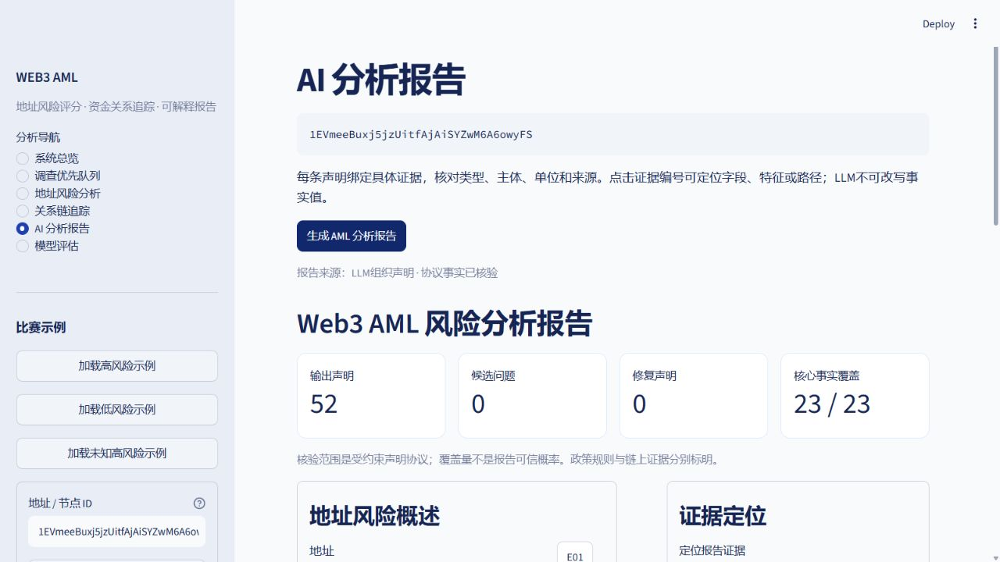

# DeepSeek Flash连接与首次真实报告验收

日期：2026-10-12。状态：官方API连接成功，一个真实地址的完整报告通过。

## 当前配置

- 服务商：DeepSeek官方API，`https://api.deepseek.com`。
- 请求模型：`deepseek-v4-flash`（用户指定名称）；[官方文档](https://api-docs.deepseek.com/quick_start/pricing/)说明此旧别名当前由V4.1 Flash服务，不能固定旧V4权重。
- 显式关闭思考模式，JSON object输出，最多8192输出token，至多一次局部修复。
- Key仅在本地`.env`；本记录及验收文件不包含密钥。

## 命令行真实验收

运行`scripts/32_check_llm_connection.py --report`，先发送小JSON连接请求，再发送一个真实公开数据地址的事实目录。

| 项目 | 实测结果 |
|---|---|
| 地址 | `1EVmeeBuxj5jzUitfAjAiSYZwM6A6owyFS` |
| 报告编号 | `report_20261012T083632_9c63389b3e62` |
| 报告来源 | `llm`，实际API响应 |
| 首轮声明通过 | 52 / 52 |
| 候选问题 / 修复 / 核心补全 | 0 / 0 / 0 |
| 必选事实覆盖 | 23 / 23，包含系统规则 |
| 报告阶段调用 | 1次，约18.86秒（含本地组织/核验/保存） |
| 报告输入 / 输出token | 10253 / 6295 |
| 小请求输入 / 输出token | 46 / 5 |
| 图边 / 冻结风险表 | 均核验通过 |
| 审计包文件哈希 | 逐文件核对通过 |

真实数据快照、声明原始响应、最终声明、核验记录和报告保存在[此次审计目录](../artifacts/reports/report_20261012T083632_9c63389b3e62/manifest.json)。连接结果见[验收JSON](../artifacts/metrics/llm_connection_acceptance.json)。

这是一个地址的首次通路验收，不是总体幻觉率或跨模型优劣实验。大模型组织受约束声明，报告数字、地址和事实文字仍由程序渲染。本次没有失败声明，因此没有验证真实模型局部修复能力；先前120次修复仍是模拟响应实验。

## 使用方式

打开`http://127.0.0.1:8501`，加载未知高风险示例，进入“AI分析报告”，点击“生成AML分析报告”。
成功时来源显示“LLM组织声明 · 协议事实已核验”；显示“结构化证据模板”说明发生回退，不能算作真实LLM报告成功。
点击E编号定位风险、特征或路径证据，完整审计包可下载。

如修改Key或连接地址，保存`.env`后重启演示服务，再运行连接检查。连接脚本不会打印Key或原始异常消息。

## 网页真实验收

同一地址通过网页再次调用DeepSeek，报告编号`report_20261012T083821_47b6b6e5ae68`。52条声明首轮通过、0问题、0修复、0核心补全；耗时约20.50秒，输入10249 token、输出6291 token（其中8960输入token缓存命中）。
来源实际显示“LLM组织声明 · 协议事实已核验”。点击E40定位到`/trace_analysis/top_paths/1/bridge_witnesses/0`，对应低分16.10→锚点61.02的有向见证。E编号随模型选择/排序变化，不能依赖旧模板编号。
通过网页下载完整审计ZIP后，逐文件核对manifest哈希通过，来源为`llm`且实际图/冻结风险核验均通过。未重训风险模型，也未调整追踪算法。

合计：1个小连接请求＋同一个地址2次真实报告请求，共3次API请求；没有修复请求。不是2个独立地址样本，也没有验证真实模型失败后的修复率。完整记录见[真实验收JSON](../artifacts/metrics/deepseek_live_acceptance.json)。

