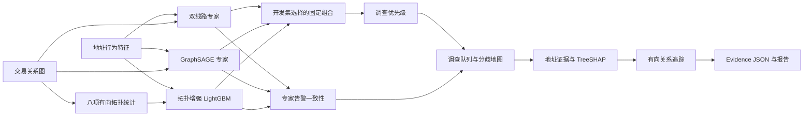

# 调查增强版：比赛设计与复现

> 历史方案，已由 V2.0 替代。当前主模型与演示见 [风险评分重构](RISK_SCORING_REDESIGN.md)。以下结果仅描述旧调查层，当前运行不加载该层。

当前亮点从“融合网络”扩展为 **异构专家互补 → 共识 / 分歧诊断 → 调查队列 → 可解释证据 → 关系追踪与报告**。
原双线路模型继续输出地址风险，调查层单独安排复核优先级。无须新增复杂图网络或联网采集。

## 三个可演示的设计

1. **拓扑增强专家**：LightGBM 输入地址行为特征和八项有向图统计。它能提供与神经专家不同的判断，TreeSHAP 能指出相关特征。
2. **共识与分歧诊断**：GraphSAGE、Dual-View、拓扑树分别按照自己的验证集阈值告警，形成共识告警、模型分歧、待复核和一致未告警四种状态。
3. **调查优先队列**：优先排查、分歧复核、排序上调三种入口；支持候选导出和一键跳转到证据、路径与报告。

这是基于成熟技术的工程组合与工作流设计，不宣称 Gate、模型集成或 SHAP 本身为原创算法。



## 算法与参数

- 拓扑特征：入度 / 出度 / 邻居数的 log1p、方向平衡、双向邻居比例、上下游平均连接度对数、孤立标志。
- 训练与验证拓扑：各阶段移除截止时间之后节点的边；不使用真实标签构造特征。
- 专家组合：`p_mix = 0.25 p_graphsage + 0.25 p_dual + 0.50 p_tree`，权重在原训练区间的两个开发时间段从 15 组候选选定。
- 调查优先级：对组合概率的 logit 再做验证集温度校准，乘以 100。
- 共识告警：三个专家都达到各自验证集 F1 告警阈值。模型分歧：有专家告警，也有专家未告警。
- 一致未告警：三个专家都低于各自告警阈值的一半；其他未告警情况标为待复核。该缓冲区只用于展示，不参与模型选择。
- 分歧地图纵轴：专家分数最大值减最小值。该差值不是错误概率，也不是统计置信区间。
- 排名前移：原双线路全量排名减调查全量排名。它描述排序变化，不代表犯罪事实或因果风险变化。

## 已完成的实验

| 方法 | AP 均值 | F1 均值 |
|---|---:|---:|
| GraphSAGE | 0.3223 | 0.3341 |
| Dual-View | 0.3089 | 0.3397 |
| 拓扑增强树 | 0.3052 | 0.3134 |
| 调查优先级组合 | **0.3642** | **0.3622** |

组合 AP 在三次对应神经专家种子下均超过 GraphSAGE，平均提升 0.0419。
纯行为树的匹配预算对照 AP 为 0.2233，加入拓扑后为 0.3052。
代表组合种子 43 按验证 AP 选择；测试 AP 0.3623、F1 0.3469。Top-500 命中 472/500（94.4%），Top-1% 命中 509/565（90.1%）。
同样复核 500 个地址时，相比原双线路队列新增命中 89 个 illicit 标签地址、移出 33 个，净增加 56 个。

预算结果仅覆盖已知标签测试地址。三个树模型未开启随机子采样，输出一致，表中多次组合主要检验神经专家随机种子敏感性。
测试集已经在此前版本被查看，因此本轮是重复基准评估；生命周期快照的时间局限仍存在。
完整报告：[REPORT.md](../artifacts/experiments/investigation_v1/REPORT.md)。

## 复现和目录

在项目目录运行，默认读取准备好的 `risk_v2` 模型，不重新训练神经专家：

```powershell
..\.venv\Scripts\python.exe scripts/13_experiment_investigation.py
..\.venv\Scripts\python.exe scripts/14_precompute_investigation.py
..\.venv\Scripts\python.exe scripts/15_report_investigation.py
..\.venv\Scripts\python.exe scripts/07_build_demo_cases.py
..\.venv\Scripts\python.exe scripts/08_validate_demo.py
..\.venv\Scripts\python.exe -m pytest -q
```

`config/investigation.yaml` 管理实验、阈值缓冲、队列规模及地图采样。实验配置变化须使用新名称，原冻结实验拒绝被覆盖。

```text
src/model/topology_features.py              八项无标签拓扑统计
src/train/investigation_experiments.py      开发、冻结、最终实验和匹配对照
src/train/investigation_report.py           完整报告与科研对比图
src/inference/investigation.py              组合、告警状态和在线索引
src/inference/precompute_investigation.py   全量离线优先级
src/explain/topology_explainer.py           Native TreeSHAP
src/ui/investigation.py                     调查队列、分歧地图和地址诊断
artifacts/experiments/investigation_v1/     冻结选择、模型、对照、报告、曲线与 CSV
artifacts/investigation/                    82 万地址优先级、拓扑缓存与示例
```

## 回来后按这条路线演示

1. 打开总览，说明公开真实数据规模和调查排序结果。
2. 进入调查优先队列，切换优先排查、分歧复核、排序上调。
3. 选择候选，点击“查看该地址的风险与证据”。
4. 对比原双线路风险、调查优先级、三个专家意见与各自阈值。
5. 展示拓扑树的 TreeSHAP 证据；正负贡献都可查看。
6. 运行有向关系链追踪，生成包含调查诊断的六部分报告。
7. 打开模型评估，展示三种子对比、拓扑消融和完整可下载报告。

实际 LLM API 仍未配置；目前报告使用证据模板回退。
