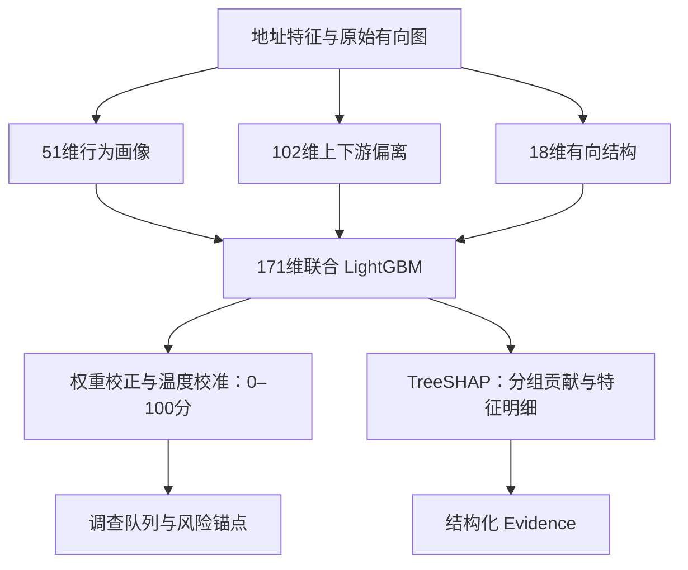
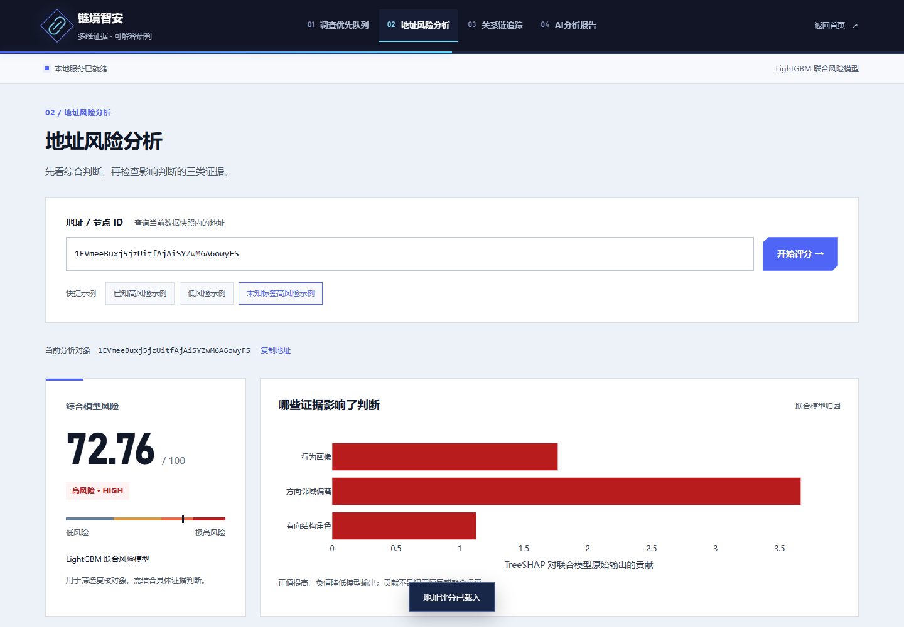

# 模块一 · 多维证据融合地址风险评分

本模块对地址输出 0–100 综合风险分，并展示影响评分的证据。它为调查队列排序，也为关系追踪提供全量地址风险表。

## 三类证据，各司其职

| 证据 | 维度 | 负责什么 |
|---|---:|---|
| 行为画像 | 51 | 地址自身交易规模、频次、手续费与活跃节奏 |
| 方向邻域偏离 | 102 | 分别比较地址与上下游行为的标准化差异 |
| 有向结构角色 | 18 | 汇入、分出、双向关联及两步连接角色 |

171 维特征输入一个 LightGBM 联合模型，经类别权重校正与验证温度校准输出综合分。三个单类模型提供诊断视角，TreeSHAP 对实际联合决策进行加性分解。

## 网页展示

“地址风险分析”支持地址或节点 ID 查询，并提供已知高风险、低风险、未知标签高风险三组快捷示例。页面展示综合风险、三类诊断、贡献条形图、特征明细及评分核对瀑布图；“继续关系追踪”将当前地址交给模块二。

## 结果与实现

在 56,436 个已知标签测试地址上，Top-100 命中 100/100，Top-500 命中 488/500（97.60%），Top-1% 命中 545/565（96.46%）；Precision 为 86.65%，ROC-AUC 为 0.8804。

| 实现位置 | 作用 |
|---|---|
| `src/model/directed_structure.py` | 有向结构角色 |
| `src/model/graph_signals.py` | 方向邻域偏离等图信号 |
| `src/train/evidence_tree_experiments.py` | 联合模型实验与选型 |
| `src/inference/evidence_scoring.py` | 单地址联合 TreeSHAP |
| `src/inference/risk_predictor.py` | 全量风险表查询与版本核对 |
| `src/inference/analysis_service.py` | 向追踪与报告提供统一分析结果 |

训练、预计算和演示分离；线上读取预计算风险表并计算单地址解释。风险等级边界为 30 / 60 / 80。复现步骤与方法来源见 [评分实现](RISK_SCORING_REDESIGN.md)。
