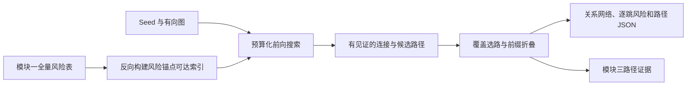
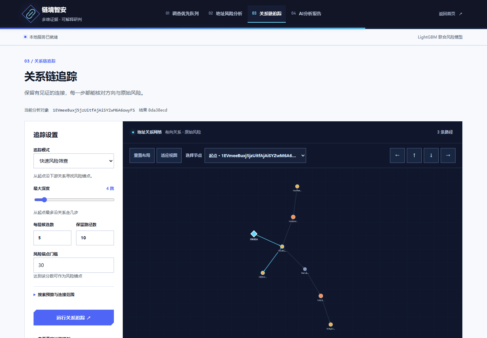

# 模块二 · 风险锚点引导的关系链追踪

本模块接收地址、原始有向图和模块一风险表，输出优先核查路径、关系网络、逐跳风险与连接见证，为模块三提供路径证据。

## 设计原理

1. **风险锚点可达索引**：以预测风险达到门槛的地址为锚点，沿入边构建反向可达距离与下一跳指针，为前向扩展提供实际有向关系见证。
2. **预算化连接搜索**：在在线关系检查预算内，优先扩展有价值路径；低于锚点门槛的节点若能通过真实方向见证连接到锚点，可保留为连接段。
3. **覆盖选路与前缀折叠**：综合路径效用、新增关系覆盖和重叠情况选择展示结果，合并严格前缀，集中呈现有信息量的关系。
4. **长链关联核查**：快速模式与长链模式共用评分和证据协议，长链模式支持最长 32 跳，并保留逐跳方向核对。

## 默认参数与界面

快速模式默认深度 4、每层候选 5、锚点门槛 30、Top-10、在线关系检查预算 2,000、连续连接长度 3。长链模式将深度设为 32、连续连接长度设为 31，仍受在线预算控制。

“关系链追踪”页面支持切换模式、选择长链案例和调整参数。主图可拖动节点、平移缩放、选择路径和恢复布局；路径明细展示节点原始风险、方向边、连接角色与见证。下载 JSON 保留完整追踪结果。

## 实验与案例

同一组 72 个评估起点，相比原 Beam，累计预测锚点 **5→23（4.6 倍）**，唯一关系边 **5→59（11.8 倍）**。这两项分别体现发现更多锚点与展开更多关系的能力。

三个精选长链案例均为 **32 跳、33 个不同地址**，各边均沿原始图方向核对。默认未知高风险案例约 72.76 分，可展示三条路径、连接段与相应见证。更多比赛讲解见 [追踪亮点](MODULE_02_COMPETITION_HIGHLIGHTS.md)。

## 实现与输出

| 源码 | 职责 |
|---|---|
| `src/tracing/anchor_index.py` | 反向多源 BFS 可达索引与连接见证 |
| `src/tracing/budgeted_tracer.py` | 风险引导、预算化搜索与结果组织 |
| `src/tracing/search_budget.py` | 在线检查预算 |
| `src/tracing/path_selection.py` | 覆盖选择、重叠处理与前缀折叠 |
| `api/runtime.py` | 绑定分析 ID、追踪参数和版本 |

输出包含 `top_paths`、有向子图、逐跳风险、连接见证、统计和预算记录。当前追踪以地址关系为基础，评分、路径和见证共同进入固定 Evidence，供报告声明引用。
