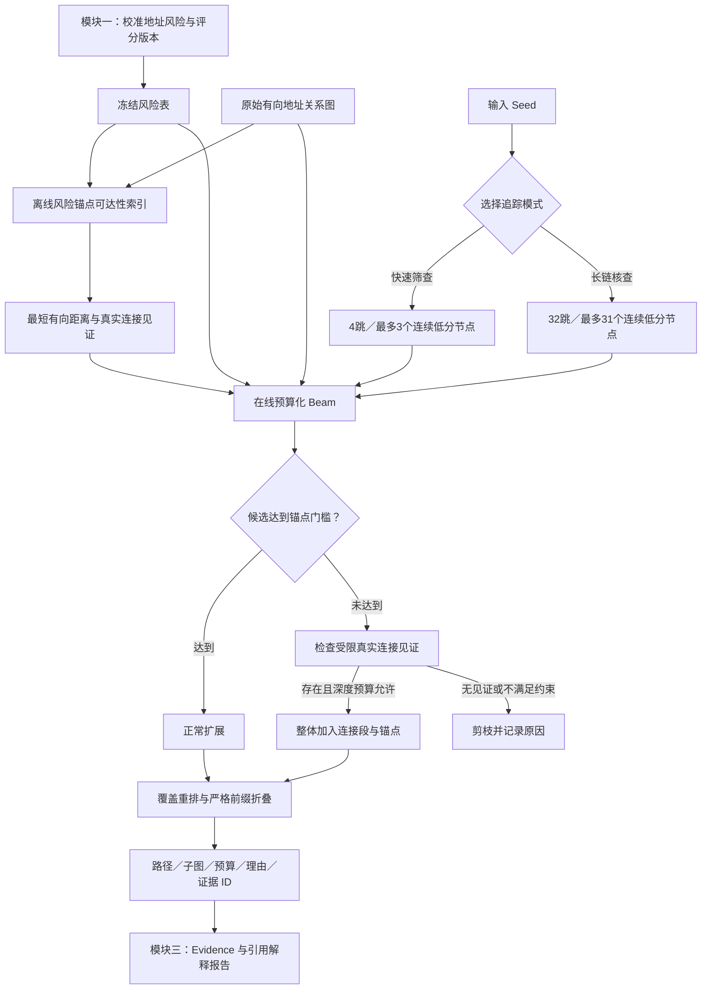
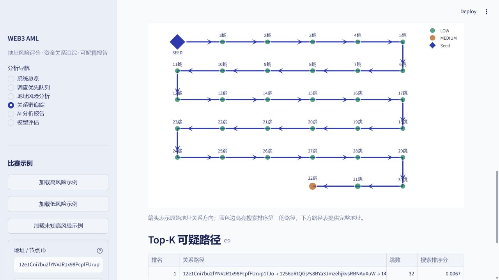
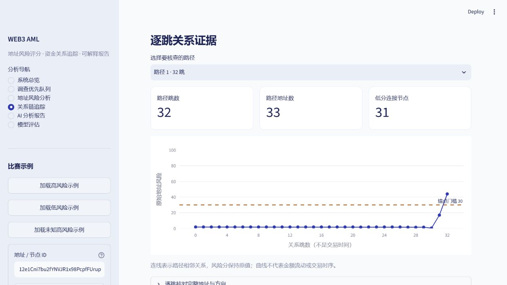

# 模块二实现记录：风险锚点约束的预算化证据路径追踪

更新：2026-10-12。状态：已实现、完成开发对照与冻结样本评估，已接入现有 Demo 和第三模块。
新增可选32跳长链核查模式，默认仍4跳；[比赛亮点与长链实验记录](MODULE_02_COMPETITION_HIGHLIGHTS.md)包含新结果及演示边界。
这是地址**关系链**追踪；当前数据没有完整逐笔金额/时间，不输出金额污染归属。
历史设计见 [初始计划](MODULE_02_RELATION_TRACING_PLAN.md)；完整 19 组结果见 [实验报告](../artifacts/experiments/tracing_v2_release_stable/REPORT.md)。

## 阅读导航

- 了解职责、结构与方法：第1–5节。
- 查前后接口、运行模式与参数：第6–8节、第12节。
- 查效果、指标含义和长链复测：第9–11节，尤其第10.1节。
- 准备比赛演示：第13节、第13.1节和第15节。
- 查源码、复现命令与验收：第14节。

本文件是模块二的完整实现入口；[比赛亮点记录](MODULE_02_COMPETITION_HIGHLIGHTS.md)用于答辩讲解，两个实验报告保留原始对照及指标边界。

## 1. 现在这块负责什么

模块一回答“地址风险有多大、依据是什么”；本模块回答“从这个地址出发，哪些真实下游关系值得复核、为什么保留”。
第三模块接收原始风险、真实路径、连接见证、搜索边界和证据引用，解释结果。
本模块没有新增评分模型，不重训模块一，也不会把低分中间节点的风险提高。

核心创新主题：**风险锚点可达性约束的证据路径追踪**。
对应痛点：逐节点阈值可能截断连接；相似路径占用展示与复核预算；搜索依据缺少可核查来源。
具体项目贡献是把预测风险、可达见证、搜索预算、路径覆盖和报告证据组织为一个轻量接口。
逆向 BFS、Beam、覆盖重排本身是已有算法，引用来源并讲清任务适配，不声称发明它们。

## 2. 清晰结构图



## 3. 三个机制各自改善什么

| 机制 | 负责的内容 | 改善目标 | 实现 |
|---|---|---|---|
| 锚点可达性索引 | 将风险达到门槛的节点作为目标，沿 incoming 边反向构建到目标的最短距离和 next-hop | 在线不必反复遍历无目标分支，能够提供真实连接见证 | 多源逆向 BFS、两份 NumPy 数组 |
| 有见证的预算化连接 | 普通扩展遵守风险门槛；低分节点必须通过真实有向连接到达风险锚点 | 跨越低分断点，控制深度、循环、连续低分数和检查开销 | 受约束连接段＋Beam；索引不适用时预算化前瞻 |
| 证据覆盖选择 | 在 Beam 和最终选路中同时考虑路径分、新增风险加权节点/边及重叠；折叠严格前缀 | 展示更多新增证据，减少重复，不把前缀算作独立资金链 | 覆盖/MMR 思想的贪心重排、确定性排序 |

这里的“风险锚点”是**达到搜索门槛的模型预测节点**。默认门槛 30，包含 MEDIUM 及以上，不能统一叫 HIGH。
“低分连接”指低于当前锚点门槛，不等于事实正常节点，也不证明其起中转作用。

## 4. 为什么没有把 PPR 保留在默认方案

先实现了 TRacer/APPR 思想的有向无权 local push，并与无 PPR、单/双/三节点桥接、覆盖重排进行对照。
在本次真实样本中，PPR-only 与原 Beam 返回覆盖相同，增加了在线检查开销；两节点桥接加 PPR 也没有额外覆盖。
因此当前默认关闭 PPR，保留其代码和实验记录。当前方案不是 TRacer 的完整复现。

开发过程中依次保留了以下目录，不覆盖不利结果：

| 目录 | 目的 |
|---|---|
| `tracing_v2_planning` | 文献元数据、旧 Demo 冗余诊断、硬阈值构造例 |
| `tracing_v2` | 初版单节点桥接/PPR 开发对照 |
| `tracing_v2_connectors` | 扩展到两/三个低分连接节点 |
| `tracing_v2_final` | 加入宽松 Beam/BFS 后过滤的更强对照 |
| `tracing_v2_anchors` | 验证离线锚点索引 |
| `tracing_v2_release` | 首次冻结评估，保留原 Beam 的 Demo 备份 |
| `tracing_v2_release_optimized` | 非多样性 Beam 的开销优化复测 |
| `tracing_v2_release_stable` | 当前版：移除无用计算、跨进程稳定求和、按版本部署索引 |

## 5. 文献借鉴与轻量适配

TRacer：IEEE TIFS 2023，[DOI](https://doi.org/10.1109/TIFS.2023.3266162)、[开放全文](https://arxiv.org/html/2201.05757)、[作者代码](https://github.com/wuzhy1ng/BlockchainSpider)。
本轮已读取全文中的第 3、4 节核心机制，文本保存在 [tracer_fulltext.txt](../artifacts/experiments/tracing_v2_planning/literature/tracer_fulltext.txt)。

- 第 3 节介绍 PPR 与残差 local push；本项目候选版实现有预算限制的无权有向传播，未处理部分质量保留为 residual。
- 第 4 节的 TRacer 包括图构建、Expand/Push/Rank/Pop 和局部社区抽取。
- TTR 进一步处理 tracing tendency、weighted pollution、temporal reasoning、token redirection；Actors 关系边不足以复现这些金额/时间/Swap 语义。
- 本项目借鉴“图搜索＋任务相关的关系优先级＋局部可审查结果”，经过对照后改为预测风险锚点的可达性索引，不借用 TRacer 的实验性能或理论保证。

另外参考：MMR（[SIGIR 1998](https://doi.org/10.1145/290941.291025)）的相关性/冗余重排；
[Diverse Beam Search](https://arxiv.org/abs/1610.02424) 的搜索多样性；
[KDD 2007 预算覆盖](https://doi.org/10.1145/1281192.1281239) 的新增覆盖思想。
DBS 的 arXiv 作者记录注明 AAAI 2018，最终 proceedings 尚未在本轮独立核对。
覆盖目标改为本图的唯一有向关系与预测风险，不继承原论文任务指标或次模近似保证。

## 6. 与模块一的接口

输入为现有校准后的 `overall_risk_score`、地址索引、有向图、已缓存 `one_hop_avg_risk`。
评分模型、评分表、评分阈值/校准以及 TreeSHAP 均未重训或改变。

- 风险 revision：`6460ec5d1ccd1ffd4d2ea54297018b0794008add93fa530c8d2942339b17f14e`。
- 数据指纹：`7c6072a04003949ef91a42ff112428766b15f929fcd24be4abb21008d88043b7`。
- 追踪 revision：`121b2e0a23afdefd962aa98f28c87b47b420cf5fd50ba53e6dde74d370851e11`。
- 图/风险地址集合及指纹不同则拒绝加载；索引绑定评分、阈值、深度、算法和数组哈希。
- 在线搜索不读取标签；unknown 不会作为正常标签参与评分或搜索。
- 不使用诊断模型分歧作为“置信度”，不把单类诊断分重新融合进追踪风险。

这次只是增加了评分后的图索引和兼容输出，没有改模块一模型。

## 7. 默认参数与实际分数

全部运行参数见 [tracing.yaml](../config/tracing.yaml)，实验矩阵见 [tracing_experiments.yaml](../config/tracing_experiments.yaml)。

| 参数 | 当前值 |
|---|---:|
| max_depth | 4 |
| beam_width | 5 |
| risk_threshold（锚点门槛） | 30 |
| max_neighbors_per_node | 50 |
| top_paths | 10 |
| edge_budget | 2,000 |
| max_bridge_nodes（连续低分上限） | 3 |
| max_bridge_candidates | 8 |
| 在线前瞻 bridge_budget_fraction | 0.30 |
| PPR | 关闭 |
| 搜索多样性 / 展示覆盖 / 前缀折叠 | 开启 |

### 7.1 快速筛查与长链核查

| 配置 | 默认快速风险筛查 | 可选长链关联核查 |
|---|---:|---:|
| 最大深度 | 4跳 | 32跳 |
| 最多连续低分连接节点 | 3 | 31 |
| 在线关系检查上限 | 2,000 | 2,000 |
| Beam宽度 / 展示路径上限 | 5 / 10 | 5 / 10 |
| 风险锚点门槛 | 30 | 30 |
| 当前离线索引深度 | 64跳 | 64跳 |

长链模式在 `tracing.yaml` 的 `long_path_profile` 配置，页面选择模式后使用对应初值，参数可调整。它扩大关系核查范围；跨度变大可能增加关系噪声，不自动提高地址风险。
两种模式共用同一追踪算法、风险表与输出接口，没有新增训练模型。离线索引支持64跳不代表页面已经返回64跳路径，当前页面最大32跳。
低分连接必须完整到达真实锚点，才整体进入候选；深度、连续低分上限、环路或预算不允许时，不输出未完成连接段充当有效路径。
阈值变化导致索引不适用时仍回退到同预算在线前瞻；长跨度前瞻可能更容易耗尽预算。

### 7.2 搜索与展示分数

节点基础扩展分沿用 `.75×风险 + .15×缓存邻域风险 + .10×度数惩罚`。
风险先归一化；路径基础分为 Seed 后节点扩展分均值乘长度衰减。
当前路径搜索分再减去 `.03×低分连接数量/跳数`。这些是搜索效用，不是资金链概率。
选择收益增加 `.30×归一化新增风险加权覆盖`，减去 `.15×与已选路径的最大有向边 Jaccard`；边覆盖权重 `.10`。
Seed 不计新增节点奖励，同一节点/边不会在已选集合中被重复奖励。

## 8. 可达见证与预算规则

离线把 `risk >= threshold` 的地址作为多个目标，从目标沿 incoming 边反向 BFS，保存 `distance.npy` 和 `next_node.npy`。
next-hop 的距离严格下降，恢复出的连接段在原图中是 outgoing 路径。
这是图可达性证据，不是新的风险分。

在线先扫描预算允许的真实下游，再按风险排序。预算不足时只扫描存储邻接序列的前段，记录该边界，不能声称已选全邻居的风险 Top-K。
一个低分连接段必须在最大深度内整体到达锚点，才进入候选；未完成前缀不直接变成报告路径。
若索引的 canonical 最短见证回到当前路径，可用同预算在线前瞻寻找其他见证；无见证则停止该分支。

每次邻接边读取、重复访问、可选 PPR 传播、在线桥接前瞻，以及缓存 next-hop 关系链接读取都计入在线预算。
节点度数、风险表和已缓存邻域均值是直接查表；离线缓存构建单独报告成本。
计数约束不是严格 CPU 时间上限，重排、序列化、模型解释和前端渲染还需时间。
本次耗时字段衡量图和风险已加载后的搜索，不包括模型/图加载、TreeSHAP 和 LLM。

离线冻结实验索引支持 4 跳，构建读取 373,783 次逆向关系；首版部署索引支持8跳，构建读取490,518次。2026-10-12新增64跳索引，构建成本见长链实验graph_diagnostics.json，页面最大32跳。
部署默认仍搜索 4 跳、最多连续 3 个低分节点。页面改变锚点门槛时，索引不适用，自动切换同预算在线前瞻，并显示原因。
索引重建时间与机器负载有关；不能用亚毫秒的温启动搜索时间宣称完整加载也如此快速。

## 9. 实验协议

在 36 个开发 Seed 上尝试组件，冻结 `indexed_bridge3` 后才运行另外 72 个评估 Seed。
Seed 按预测风险三个区间、已知/unknown 六组分层抽样，并要求出度大于零；每组开发 6 个、评估 12 个。
已知开发来自 validation，评估来自 test；unknown 按 node index 奇偶分池。
三组风险区间均等加权，这不是全图自然分布平均。九个展示 Demo 不用于调参。

19 个对照涵盖有界 BFS、旧 Beam、门槛 10/0 的 Beam、宽松搜索后仅保留锚点终点、PPR、不同桥接长度、覆盖重排和移除组件。
同 Seed、风险版本、图、4 跳深度、2,000 次**在线**检查上限和最终 Top-10。
实际访问数与离线索引成本不同，分别报告。算法执行顺序固定种子打乱，缓存邻域上下文一致。
原始配置、源码 revision、Seed 清单和冻结选择都保存。

选择当前方案依据是在线成本、真实见证和可审核接口，而非声称所有覆盖指标最优。
这个公开数据已经用于模块一开发；本轮追踪评估采用不同 Seed，但仍不属于独立外部盲测。
首次冻结后移除了非多样性对照中的无用重叠计算，并改为排序求和以消除进程 hash seed 引起的浮点尾差。
当前计时是同一 72 Seed 的重复评估，没有重新选模型/参数。1,368 条逐方法结果的非计时指标在 1e-12 容差内一致；当前记录明确 `evaluation_previously_observed=true`。

## 10. 冻结真实样本效果

下表为 72 个 Seed 的**逐 Seed 去重后累计**；不同 Seed 可以重复发现同一个地址/边，不是全局唯一总量。
风险锚点由预测分 ≥30 定义，不能作为洗钱路径真值。

| 方法 | 锚点累计 | 唯一边累计 | 有路径的 Seed | 已知 illicit 节点命中累计 | 平均在线检查 | 搜索 p95 ms |
|---|---:|---:|---:|---:|---:|---:|
| 旧风险 Beam（预算化对照） | 5 | 5 | 4 | 2 | 2.514 | 0.089 |
| 当前锚点见证方案 | 23 | 59 | 17 | 8 | 3.917 | 0.175 |
| 门槛 0 Beam＋锚点终点过滤＋覆盖 | 32 | 56 | 15 | 12 | 105.194 | 1.525 |
| 有界 BFS＋锚点终点过滤＋覆盖 | 71 | 117 | 17 | 19 | 268.208 | 5.078 |

当前方案比原 Beam 找到更多锚点和关系，增加了少量在线检查；不能写成“速度比原 Beam 更快”。
宽松搜索后过滤/BFS 能覆盖更多锚点和已知 illicit 节点，当前方案没有全面胜出。
已知 illicit 命中仅作离线辅助；标签没有输入搜索，unknown 不能计为误报。

相对原 Beam 的每 Seed 锚点增加均值为 .25，分层配对 bootstrap 描述区间为 [.125,.3889]。
已知 illicit 命中增加区间包含零，不能声称此项显著改善。
当前方案与无索引三节点在线桥接比平均检查 3.917 vs 98.528；离线构建约 373,783 次读取，按读取量需约 3,951 次查询才摊销平衡。
这只是读取数的比较，不是实际成本的普适保证。


### 10.1 长链模式探索性复测

2026-10-12，在已经观察过的36开发起点和72评估起点上比较六种深度/低分跨度配置。
这是同一公开样本的探索性复测，不能作为新增独立盲测；没有更改模块一风险分。完整记录见[长链实验报告](../artifacts/experiments/tracing_long_paths_v2/REPORT.md)。

| 72个评估起点 | 4跳／跨度3 | 16跳／跨度3 | 32跳／跨度31 |
|---|---:|---:|---:|
| 至少返回一条路径的起点 | 17 | 17 | 19 |
| 返回最长路径 | 4跳 | 11跳 | 11跳 |
| 至少返回8跳路径的起点 | 0 | 1 | 1 |
| 逐起点去重关系边累计 | 59 | 74 | 99 |
| 逐起点去重预测锚点累计 | 23 | 26 | 34 |
| 平均在线关系检查 | 3.92 | 12.72 | 13.07 |

增加深度让部分结果更长，但非空起点仍为17；进一步放宽完整低分连接跨度后增加到19。
`17/72`或`19/72`表示测试起点的非空结果率，不表示追回了多少条真实资金链。当前没有完整洗钱路径真值，因此无法测量真实资金链召回率。
不同起点可能发现同一个地址或关系边，累计指标不是全局唯一总量。

另外按最短锚点距离挑选了3个32跳展示起点，每条返回33个不同地址，逐边在原始有向图核对，在线检查33次。它们不计入72个起点的性能表。
这三个样例起点风险约1.77，终点41.20–49.44，属于MEDIUM；长链证明远距离关联核查能力，不证明洗钱或同一笔资金连续转移。
64跳索引构建检查508,625次逆向关系，本次构建约0.63秒；加载图、风险、上下文及构建索引合计约7.71秒。成本见[全图诊断](../artifacts/experiments/tracing_long_paths_v2/graph_diagnostics.json)，受机器与缓存影响。

方法矩阵在运行前保存；首次日志遗漏基础配置快照，完整基础配置可从保存的路径结果恢复。
该缺口记录在[协议日志修正说明](../artifacts/experiments/tracing_long_paths_v2/protocol_logging_correction.json)，原记录保留，后续复现脚本已修正。

## 11. 构造机制验证与消融

48 个机制图覆盖低分连接、八条平行分支、高连接噪声、循环与死端；每类 12 个固定种子实例。
这些不是真实 AML 标签或连续金额资金链。

| 机制 | 旧 Beam 的植入目标恢复 | 当前方案 | 用途 |
|---|---:|---:|---|
| 低分连接 | 0% | 100% | 验证硬门槛断点恢复 |
| 高连接噪声 | 0% | 100% | 验证直接风险筛选可能丢失低分入口 |
| 循环与死端 | 0% | 100% | 验证真实见证、环路与无目标分支 |
| 八条平行分支 | 51.04% | 62.50% | 验证有限 Beam 下的分支覆盖 |

平行分支去掉多样性/前缀处理后恢复率回到 51.04%；平均重复边比例从 .5648 降到 .2667。
该图形上宽松 Beam＋覆盖同样达到 62.50%，不能把这项收益全部归给索引。
真实 72 Seed 中，多样性没有改变累计覆盖，但减少了重复前缀/边出现；收益范围需分别陈述。

## 12. 给第三模块的输出契约

保留旧字段 `seed_address/config/statistics/top_paths/subgraph`，新增可选字段，兼容原调用方。

| 字段 | 内容 / 单位 | 解释范围 |
|---|---|---|
| provenance | 数据指纹、risk_revision、tracing_revision、config_hash | 可追溯到本次图、评分、算法和参数 |
| search_budget | 在线检查数、分阶段计数、ms、停止原因 | 说明本次搜索范围，不证明未发现的关系不存在 |
| top_paths[*].path_id | 数据/评分版本＋节点序列的稳定 ID | 同路径跨参数可对应 |
| top_paths[*].evidence_id | 加入算法/config 的证据 ID | 对应一次确定算法配置下的路径说明 |
| bridge_nodes / bridge_witnesses | 低分节点、真实有向边、锚点、原因代码 | 说明为何保留连接，不声称非法转运 |
| score_components | 基础路径分、可选 Seed 相关分、桥接惩罚 | 与地址风险分区别说明 |
| selection / selection_analysis | 新增节点/边、覆盖、重叠、前缀折叠 | 说明展示理由与独特证据量 |
| anchor_reachability | 索引来源、离线构建边界 | 区分离线见证和在线搜索 |
| amount_evidence / transaction_time_evidence | unavailable | 报告不得补造金额/时序 |

Evidence Builder 检查 Seed 与评分/数据版本一致，将新增字段直接传给 `trace_analysis`。
模板报告展示预算、路径证据 ID 与低分连接理由；LLM 提示词要求引用这些字段并保留限制。
现有字段引用验证并不保证全部语义正确；更强的声明类型核验属于模块三下一阶段。
真实 LLM API 尚未配置，本轮通过的是模板闭环及已有模拟成功/失败测试。

## 13. 当前比赛示例变化

默认 Seed `1EVmeeBuxj5jzUitfAjAiSYZwM6A6owyFS`，模块一风险仍为 **72.7625**。
旧版 4 条路径中有 2 条严格前缀、4 条唯一边；当前展示 3 条最大路径序列、7 条唯一边，最深 4 跳。
当前搜索检查 11 次关系（邻接扫描 10、索引见证链接 1），折叠 3 条已生成前缀。
三条结果仍共享前段，不能称为三条独立资金链。
一条低分连接地址风险 **16.0960**，因为存在真实下游至风险 **61.0190** 的节点而被保留，风险没有提高。

原来的低风险 Demo 现在也可能出现通往风险锚点的关系路径；这不改变其低风险评分，不证明该地址非法。
九个原有 Demo ID 不变，旧配置/报告/路径备份在 release 下的 `previous_demo/`。

桌面与 375px 页面核对了锚点门槛、3 条路径、低分角色、见证、预算和无页面横向溢出。
截图：[桌面总览](screenshots/tracing_v2_desktop.png)、[连接见证](screenshots/tracing_v2_witness.png)、[375px](screenshots/tracing_v2_mobile.png)。
历史 `evidence_tracing.jpg` 对应旧 Beam，不能用作当前截图。

### 13.1 长链演示与逐跳核查

页面提供“真实长链样例”入口，案例清单绑定当前评分与数据版本，保存在[长链案例清单](../artifacts/tracing/long_path_cases.json)。

| 样例起点 | 返回最长路径 | 起点风险 | 路径终点风险 | 来源 |
|---|---:|---:|---:|---|
| `12e1Cni7bu2fYNVJR1x98PcpfFUrup1TJo` | 32跳 | 约1.77 | 43.95 | 按距离精选 |
| `145sW3LTfrA4PsPgBdEz285Ppi46gydMmG` | 32跳 | 约1.77 | 49.44 | 按距离精选 |
| `15jCARCfVd1u6L31GaxE4mfvundneiRGRv` | 32跳 | 约1.77 | 41.20 | 按距离精选 |
| `17m7vN4jkWEAVvDZ537F36wQiENgxLnyhM` | 11跳 | 约0.08 | 36.05 | 原72个评估起点之一 |

演示步骤：进入关系链追踪页，展开真实长链样例，加载起点，确认长链模式参数，再运行追踪。
逐跳视图默认选择返回结果中最长的路径，显示跳数、不同地址数、低分连接数、风险曲线和完整地址表。
单条长链采用有向蛇形布局，箭头逐段保留；节点编号是关系跳数，不是时间。曲线保留原始风险，不表示金额流动。
扫描候选只统计邻接扫描发现的地址；保留节点还包含离线见证展开的地址，因此这两个计数范围不同。
生成报告时使用当前追踪结果及证据编号，模板说明完整低分连接段的节点数量。真实LLM API仍未验收。





## 14. 文件与复现

| 文件 | 职责 |
|---|---|
| [anchor_index.py](../src/tracing/anchor_index.py) | 逆向多源索引、数组哈希、真实连接见证 |
| [budgeted_tracer.py](../src/tracing/budgeted_tracer.py) | 预算化搜索、桥接、版本、理由与兼容输出 |
| [search_budget.py](../src/tracing/search_budget.py) | 请求内计数、阶段配额、流式邻接扫描 |
| [path_selection.py](../src/tracing/path_selection.py) | 覆盖重排、前缀折叠和去重指标 |
| [local_relevance.py](../src/tracing/local_relevance.py) | 留作对照的有向无权 APPR 候选 |
| [beam_search.py](../src/tracing/beam_search.py) | 保留原 V1 算法 |
| [24_experiment_relation_tracing.py](../scripts/24_experiment_relation_tracing.py) | 构造机制、开发/评估分层 Seed、19 组对照 |
| [25_deploy_relation_tracer.py](../scripts/25_deploy_relation_tracer.py) | 评估前冻结、风险/源码核对、备份与部署 |
| [26_summarize_relation_tracing.py](../scripts/26_summarize_relation_tracing.py) | 完整对比、配对描述区间、PNG/SVG 科学图 |
| [27_explore_long_relation_paths.py](../scripts/27_explore_long_relation_paths.py) | 六种长链配置、重复起点与精选样例分开记录、逐边验证 |
| [28_publish_long_path_cases.py](../scripts/28_publish_long_path_cases.py) | 安装已验证64跳索引和真实长链样例，保留快速默认模式 |
| [path_detail.py](../src/ui/path_detail.py) | 逐跳风险、完整地址表与路径选择 |
| [tracing_long_paths.yaml](../config/tracing_long_paths.yaml) | 长链参数实验矩阵 |

在新实验目录复现，保留现有 release 记录：

```powershell
python scripts/24_experiment_relation_tracing.py --split development --experiment tracing_v2_reproduce
python scripts/25_deploy_relation_tracer.py --freeze --experiment tracing_v2_reproduce
python scripts/24_experiment_relation_tracing.py --split evaluation --experiment tracing_v2_reproduce
python scripts/26_summarize_relation_tracing.py --experiment tracing_v2_reproduce
python -m pytest tests/test_budgeted_tracing.py tests/test_tracing.py tests/test_evidence_builder.py -q
# 可选：通过当前风险/源码版本核对后安装，并备份原 Demo。
python scripts/25_deploy_relation_tracer.py --experiment tracing_v2_reproduce
python scripts/08_validate_demo.py
```

当前索引：`artifacts/tracing/anchor_index/` 下的评分/算法版本目录；具体路径由 `config/tracing.yaml` 给出。重复部署复用已验证数组，避免覆盖被 Windows 服务 mmap 读取的文件。部署与九个案例验收：`artifacts/tracing/deployment.json`。
2026-10-11验收为 **73 passed、2 skipped**；2026-10-12增加5项长链约束测试后，全套 **78 passed、2 skipped**。两个跳过项仍属于旧调查层revision不匹配。
9个原Demo闭环通过；浏览器验证32跳、33个不同地址、33次在线检查，模板报告证据引用通过。来源见[最新长链验收](../artifacts/metrics/long_path_acceptance.json)。
新增测试涵盖桥接方向、两低分连接、深度、环路、预算、高连接限制、残差守恒、独立最短路径核对、索引哈希、引用和版本错配。

长链阶段另验证32跳完整见证、原始评分不变、深度不足/跨度不足/预算不足时不输出未完成路径，以及模块三的证据引用传递。
复现长链实验时使用新目录，保留已有结果：

```powershell
python scripts/27_explore_long_relation_paths.py --experiment tracing_long_paths_reproduce
python -m pytest tests/test_long_relation_paths.py -q
```

初次长链尝试保存在 `tracing_long_paths_v1`：挑选的起点距离超过测试的32跳范围，所有配置无结果。
后续 `tracing_long_paths_v2` 将展示筛选范围限定在实际测试深度内；失败记录保留，精选案例不进入总体性能统计。

## 15. 可以讲与不能讲

模块二只对应一个核心创新，下列四个可展示价值共同支撑它：

| 可展示价值 | 答辩讲法 | 实际证据 |
|---|---|---|
| 跨越低分断点 | 局部低风险也可能连接到值得继续复核的下游 | 16.10分地址到61.02分地址的真实连接 |
| 核查远距离关联 | 快速查近邻，长链模式查更远的完整连接 | 原评估起点最长11跳；另有三个真实32跳精选案例 |
| 减少重复证据 | 优先增加有效关系，减少重复前缀占用展示名额 | 默认案例4条/4唯一边变为3条/7唯一边 |
| 逐跳可审核 | 说明为何继续追、风险多少、搜索边界在哪里 | 原始评分、完整地址、见证、预算、证据ID及报告引用 |

建议主讲句：**利用风险锚点的真实连接见证，跨越低分断点、核查远距离关联，并让每条结果的原始评分和搜索依据都可审核。**
追得长属于能力，核心方法价值来自风险目标、真实见证、预算与覆盖选择的结合；长路径长度本身不计为独立原创算法。

可以讲：在固定在线检查上限下，利用风险锚点可达见证跨越低分断点；候选与展示受预算和覆盖约束；每段连接及版本可被报告核查。
可以展示：与旧 Beam 的本样本锚点/关系覆盖提升，构造机制恢复，真实 Demo 的低分连接见证，以及宽松搜索的覆盖/开销权衡。
不能讲：洗钱资金链准确率 100%、已复现完整 TRacer、PPR 全面提升、三个独立资金链、全流程亚毫秒或 unknown 真值命中率。

后续优先扩大按出度/连接形态分层的评估，验证单 canonical 见证遗漏；有真实逐笔金额/时间来源时再另建金额级任务。
