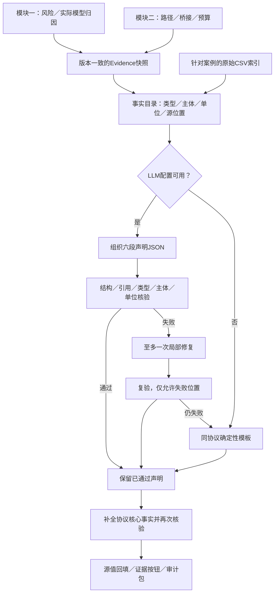
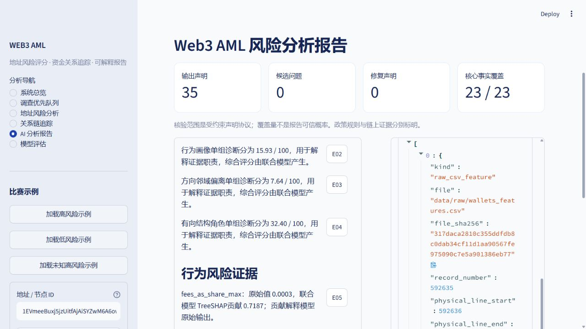
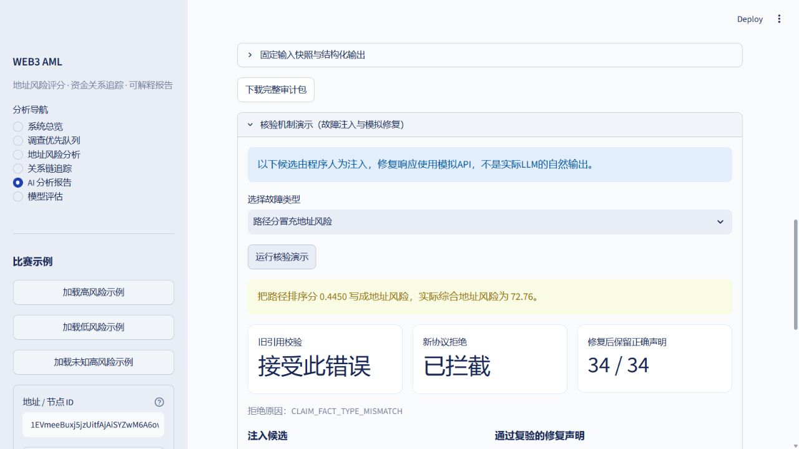

# 模块三实现记录：证据类型约束的可审计解释报告

更新：2026-10-12。状态：**核心协议、声明核验、有限局部修复、精确定位、审计包及当前案例的原始CSV来源索引已实现并接入Web**。
DeepSeek官方API已完成首次真实验收（1地址、2次报告均52条声明通过），见[连接记录](DEEPSEEK_CONNECTION.md)。下文120故障/模拟修复实验与真实调用分开记录，不能写成总体自然生成幻觉率下降。
历史设计见[设计方案](MODULE_03_EXPLAINABLE_REPORT_PLAN.md)，完整结果见[实验报告](../artifacts/experiments/report_v3_release_stable/REPORT.md)。

## 1. 职责、痛点与核心创新

模块一产生地址风险与实际模型依据；模块二产生有向关系路径与真实连接见证；模块三负责准确组织它们，并将报告声明定位回源证据。
核心创新主题：**用带类型、主体、单位和来源的事实约束报告声明，使生成、核验、局部修复与证据定位形成闭环。**
它针对三类问题：编造事实；引用真实字段但解释错；读者无法定位一句话的依据。
不是通用任意自然语言的形式证明。默认协议主动限制事实表达空间，程序回填数值，LLM负责选择事实与组织声明。

## 2. 四个能演示的价值

| 价值 | 具体实现 | 验证/展示 |
|---|---|---|
| 结构化输入与输出 | 固定Evidence→程序事实目录→六段声明JSON→事实渲染 | JSON Schema、声明类型/主体/单位、原值回填 |
| 引用含义核验 | 地址风险、诊断分、图统计、SHAP、路径效用分别注册类型 | 路径事实不能声明成地址风险，单位与主体不可互换 |
| 声明定位到具体位置 | E编号→稳定事实ID→RFC 6901 Pointer→特征行或路径段 | 默认案例的桥接声明定位第二条路径及16.10→61.02连接 |
| 有限局部修复与留痕 | 保留已通过声明，至多一次API修复，再失败局部模板/核心事实补全 | 原始候选、错误、修复与最终声明均保存 |

四个价值共同支撑模块三一项创新。模块一评分和模块二搜索算法未重训/改变。

## 3. 当前流程



传入真实图和风险表时，还检查路径每条边真实存在、节点风险与冻结风险表一致。
对原始Evidence不做修复：来源错配、伪造路径或风险不一致直接拒绝，不能用语言生成替代事实修正。

## 4. 输入和声明协议

### 4.1 事实目录

`FactCatalog`深拷贝输入，记录Evidence SHA256与事实目录SHA256。事实ID绑定版本、类型、Pointer、主体和值。
事实记录包含`fact_type`、`subject`、`unit`、`value`、`source_pointers`、`source_values`、`source_version`、`display_locator`和可用的`raw_source_locations`。
程序注册事实类型，LLM不能修改目录或从元数据拼出新的风险事实。

已注册类型：`address_model_risk`、`diagnostic_score`、`feature_attribution`、`graph_observation`、`relation_path`、`path_node_risk`、`bridge_reason`、`search_boundary`、`review_recommendation`、`limitation`。
建议/边界规则单独标明为系统规则，不冒充链上观测。

### 4.2 六段输出

固定`overview/behavior/graph/paths/assessment/limitations`。每条声明只引用一个复合事实，必须匹配其主体、类型、单位和所属段落。

```json
{
  "claim_id": "C_example",
  "claim_type": "address_model_risk",
  "fact_ids": ["E_对应目录中的真实ID"],
  "subject": {"address_id": "对应地址"},
  "unit": "score_0_100",
  "wording": "standard"
}
```

上例为结构示意；生产ID由程序生成。禁止额外`text/value`等事实自由文本字段；`wording`仅允许受支持的选项。
严格渲染从源事实读取数字、地址、路径长度与归因，不接受LLM自行重写这些值。
`response_format=json_object`保证不了内容正确，仍执行独立结构与类型校验。

## 5. 核验规则与修复边界

- JSON Pointer检查RFC 6901转义，只允许规范非负数组下标；值不存在/无法下钻时拒绝。
- 检查六段齐全、声明唯一、事实不重复、字段合法、列表/响应长度限制；拒绝重复JSON键与非有限值。
- 引用事实的类型、主体、单位和section必须一致；路径排序分不会成为地址风险。
- 检查Seed、路径长度、无环、节点风险范围、桥接连续性与锚点门槛；有真实图/风险表时再核对真实边和原值。
- 修复只接受原失败的`section+position`，不能改写已通过声明、源Evidence或插入未请求的位置。
- 最多一轮修复；失败后对可定位事实使用正确类型模板，其余无支持声明不进入报告，再补全必选事实。
- 最终文档重新核验；保留来源通过、修复通过、局部模板、核心事实补全的状态。

报告核心覆盖包括综合风险、单组诊断、每组至少一项归因、指定图统计、全部返回路径/桥接、预算和系统边界；其余事实可选择。
覆盖值是协议必选事实的覆盖量，包含系统规则，不能表述为报告可信概率或对全部输入信息的召回率。
正确内容保留受最终声明上限约束，发生限额省略时在审计记录`valid_omitted_by_limit`，不隐瞒。

## 6. 证据可以定位到哪里

| 证据 | 当前定位 | 原始来源边界 |
|---|---|---|
| 地址风险 | 具体Pointer、地址、源值、版本 | 模型输出，不能虚构原始CSV中的“风险列” |
| 联合树归因 | 特征组、Top-K证据表行、原值/模型输入、贡献 | 原始行为特征可链接CSV记录；派生特征/SHAP仍来自模型Evidence |
| 路径/路径节点 | path_id、路径下标、具体跳、完整地址/原始风险 | 页面高亮对应节点或相邻边，保留32跳全路径 |
| 桥接理由 | bridge_witnesses具体下标、完整见证边段 | 蓝色高亮连接段；有索引时展示每条原始关系记录 |
| 预算/政策 | 具体字段或系统规则名 | 明确区分搜索边界、复核建议与链上事实 |

当前来源索引覆盖154个地址的最新特征记录、139对有向关系，按当前案例离线构建，不是822,942个地址的全量索引。
选址策略复现预处理的latest_timestep、稳定排序、同时间选最后记录及缺失时间排最后；已逐行与处理后的float32特征表核对。
CSV记录序号、物理起止行分别测量，支持引号内换行；边重复记录数量保留，原始关系记录不等同独立逐笔交易。
每条定位绑定原始文件SHA256与索引SHA256；运行时检查索引一致性及文件大小/mtime，新原始文件变化使该索引不可用。
哈希用于本地快照一致性，不是签名、不可篡改存证或司法证据链。
原CSV链接支持原始特征值核查，不证明SHAP贡献；贡献仍来自冻结模型输出。没有交易哈希、逐笔金额/时间时不补造它们。

## 7. 审计保存与兼容接口

保留旧返回字段`markdown/source/fallback_reason`和按地址保存的报告；增加`protocol/report_id/statements/fact_catalog/claims_document/audit/candidates/bundle_path`。

每次运行保存独立目录：

```text
artifacts/reports/report_<UTC时间>_<唯一后缀>/
├── evidence.json
├── fact_catalog.json
├── claims_raw.json
├── claims_validated.json
├── audit.json
├── report.md
└── manifest.json
```

`manifest`记录文件哈希；Web可下载包含这些资料的ZIP。报告编号唯一，不覆盖同一地址的历史审计运行。
候选审计保留原始响应、错误代码、修复响应、已通过保留数、局部模板数、覆盖补全、调用数与耗时。
不保存API密钥或完整连接配置。离线来源索引在`artifacts/reporting/source_index.json`。

## 8. 真实实验结果及解释范围

当前正式实验：[report_v3_release_stable](../artifacts/experiments/report_v3_release_stable/REPORT.md)。12个变体×10类故障，共120个人为注入用例；12个正确协议用例。

| 指标 | 旧六段字符串引用校验 | 新受约束声明协议 |
|---|---:|---:|
| 人为故障拒绝 | 24 / 120 | 120 / 120 |
| 正确协议样例通过 | 表达协议不同，不直接对应 | 12 / 12 |
| 模拟正确修复响应通过 | 本轮未比较 | 120 / 120 |
| 模拟修复后已通过声明保留 | 本轮未比较 | 1200 / 1200 |

还验证10个真实Evidence案例（9个原Demo＋一个真实32跳起点）：图中边、冻结风险、完整快照、必选事实覆盖与定位范围均通过。
模拟修复只验证接受合规修复且保护已通过声明，不是实际模型修复成功率；单元测试另覆盖失败修复、越权修复、空输出与异常回退。
表达空间不同：新协议通过限制事实自由文本和程序渲染来减少错误，不代表通用语言理解全面提升，也不能换算自然LLM幻觉下降80%。
这组协议实验未包含真实API输出。后续DeepSeek首次通路验收记录了实际token和两个受约束响应；尚无自由事实文本、总体自然幻觉率或跨模型生成质量对照。
旧初版实验`report_v3_release`保留；正式结果使用修正内部Seed一致性检查、来源行号检查后的独立目录，不覆盖历史结果。

## 9. 文献与适配

- [ALCE：EMNLP 2023](https://aclanthology.org/2023.emnlp-main.398/)，借鉴正确性和引用支持评价；本项目引用对象改为固定AML事实，增加类型、主体和单位核验。
- [RARR：ACL 2023](https://aclanthology.org/2023.acl-long.910/)，借鉴检查后修订与有效内容保留；本项目用封闭Evidence与规则反馈做有限局部修复。

已核实官方元数据/摘要，来源保存在[文献记录](../artifacts/experiments/report_v3_planning/literature_metadata.json)。这是任务适配，没有完整复现两篇方法或继承原论文benchmark指标。

## 10. 文件导航、运行与验收

| 文件 | 职责 |
|---|---|
| [fact_catalog.py](../src/report/fact_catalog.py) | 冻结来源、注册事实、Pointer与主体/路径检查 |
| [claim_schema.py](../src/report/claim_schema.py) | 六段声明Schema、规范蓝图 |
| [claim_validator.py](../src/report/claim_validator.py) | 逐声明结构/类型/主体/单位核验 |
| [claim_renderer.py](../src/report/claim_renderer.py) | 源值回填、安全文本与定位索引 |
| [audited_reporter.py](../src/report/audited_reporter.py) | API、有限修复、局部回退和最终复验 |
| [report_audit.py](../src/report/report_audit.py) | 唯一审计包、版本与哈希 |
| [source_locator.py](../src/report/source_locator.py) | 针对案例的原CSV定位与索引检查 |
| [fault_demo.py](../src/report/fault_demo.py) | 明确标注的人为故障与模拟修复展示，使用实际核验流程 |
| [llm_reporter.py](../src/report/llm_reporter.py) | 当前兼容入口；legacy_reporter仅作旧基线 |
| [report_evidence.py](../src/ui/report_evidence.py) | 报告证据按钮、特征表与路径段高亮、ZIP下载 |
| [reporting.yaml](../config/reporting.yaml) | 协议、修复次数、长度/事实/声明限额、显示精度与来源索引 |
| [30_experiment_audited_reports.py](../scripts/30_experiment_audited_reports.py) | 故障对照、模拟修复、真实案例验收 |
| [31_index_report_sources.py](../scripts/31_index_report_sources.py) | 最新CSV记录与边对索引、处理表核对 |

```powershell
python scripts/31_index_report_sources.py
python scripts/30_experiment_audited_reports.py --experiment report_v3_reproduce
python -m pytest tests/test_audited_reporting.py tests/test_report_source_locations.py tests/test_evidence_builder.py tests/test_ui.py -q
streamlit run app.py
```

全套自动测试104 passed、2 skipped（48.16秒）。模块三新增26个参数化测试实例涉及受约束报告、指针、来源/分数一致性、原CSV定位、篡改、局部修复、长链保留及故障演示。三类演示验证原报告不变、只修复错误位置、正确声明全部保留，磁盘审计包与下载ZIP的哈希逐文件核对通过；两个skip仅为历史调查层版本不同。
原9个Demo闭环通过。早期页面截图为模板；后续DeepSeek真实网页报告显示LLM来源。全套接口适配后107 passed、2 skipped；真实API首次验收另列，后续扩大样本再测实际修复率。

## 11. 比赛演示建议

1. 生成默认高风险地址报告，指出风险来自模块一，路径来自模块二。
2. 点击低分连接声明的证据编号，展示第二条路径、蓝色连接段、16.10与61.02原始风险及具体Pointer。
3. 点击行为特征声明，展开原始CSV记录、记录序号/物理行与源值，区分原始特征和模型归因。
4. 下载审计包，打开原始候选/错误/最终声明与哈希清单。
5. 展开“核验机制演示（故障注入与模拟修复）”，选择“路径分冒充地址风险”，点击“运行核验演示”：旧引用规则接受，新协议因类型错配拦截；模拟修复1条，保留34/34条正确声明。另可演示编造中文金额与地址主体错配。原报告不被替换，演示审计包标记`fault_demo`及模拟范围。

网页实测定位：默认地址的行为特征E05对应`/scoring_analysis/evidence/behavior/0`，原CSV第592635条记录、物理行592636，列`fees_as_share_max`，原值`0.0003168`。桥接E26对应`/trace_analysis/top_paths/1/bridge_witnesses/0`。





主讲句：**报告的每条事实声明都绑定具体来源，系统核对证据类型与主体，再将读者带回特征、路径或原始记录的位置。**

## 12. DeepSeek Flash接口适配（2026-10-12）

用户首次连接目标为`deepseek-v4-flash`，保留指定模型名；[官方模型表](https://api-docs.deepseek.com/quick_start/pricing/)说明该旧别名当前转到DeepSeek-V4.1-Flash，不能固定旧版V4权重。
配置`LLM_PROVIDER=deepseek`，官方URL为`https://api.deepseek.com`；Key在项目`.env`中本地填写，不写入文档、日志或审计包。

请求显式发送`extra_body.thinking.type=disabled`、JSON object和8192输出token上限；通用服务商不接收thinking字段。返回`finish_reason=length`直接认定截断，不能将截断响应当成成功。支持带BOM的Windows配置文件，现有环境变量仍优先；改动Key后建议重启服务。

新增`scripts/32_check_llm_connection.py`：默认只用128输出token额度探测JSON连接；`--report`再发送一个真实公开数据案例，经实际图和冻结风险表核验。区分API连接成功、有效LLM声明和模板回退，记录首轮通过、修复/核心补全、错误、耗时及审计包位置。全程不打印Key及可能带连接信息的异常原文。

接口适配后独立回归实验目录为`report_v3_deepseek_adapter`，旧`report_v3_release_stable`保留原始代码版本；两者均是人为故障、模拟修复、真实Evidence离线验收，不是DeepSeek自然输出实验。本地Key已填写并完成实际调用，结果见[DeepSeek真实连接记录](DEEPSEEK_CONNECTION.md)。
