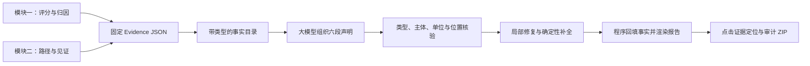
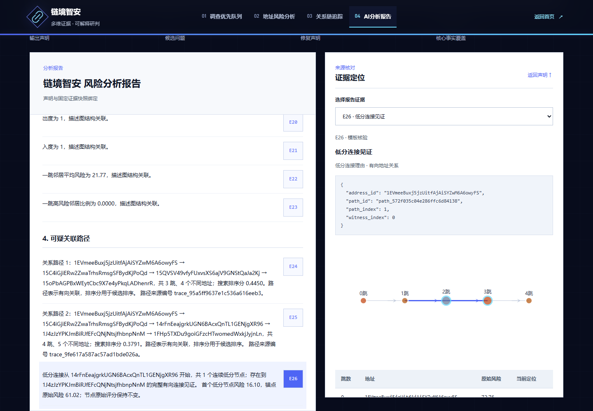

# 模块三 · 证据约束的可解释研判报告

本模块将地址评分、特征归因、关系路径和连接见证转成可核验的研判材料。网页中的声明、定位结果和下载文件共享同一份 Evidence 快照。

## 从证据到报告

## 模块内部设计

| 设计 | 作用 |
|---|---|
| 固定输入快照 | 将同一地址、模型版本、评分和追踪结果绑定 |
| 带类型事实目录 | 为每项事实注册类型、主体、单位和来源位置 |
| 结构化声明协议 | 报告按六段组织，每条声明引用程序登记事实 |
| 独立核验 | 检查分数类型、地址主体、单位及路径是否匹配 |
| 一次受限局部修复 | 定位失败声明并修复，保留已通过内容 |
| 程序事实渲染 | 从固定 Evidence 回填数值、地址和路径 |
| 证据导航与审计 | 定位字段、特征行和路径段，导出证据、候选、声明、核验记录与哈希 |

## 网页操作

“AI分析报告”支持“自动选择报告来源”和“结构化证据模板”。点击生成后展示六段报告、声明编号与核验结果；选择证据编号定位到具体依据。尚未追踪时，系统先补全默认追踪，再生成报告。

可下载 Markdown、TXT、Evidence JSON 和完整审计 ZIP。故障演示提供“路径分冒充地址风险”“编造金额”“主体替换”等人为注入案例，展示拦截与模拟局部修复过程。

## 验证结果

- 120 个人为故障全部被新协议拦截；12 个正确协议用例通过。
- 120 次模拟局部修复成功，1,200 条已通过声明完整保留。
- 已有真实 DeepSeek 报告两次各生成 52 条声明并首轮通过核验；新版前端也完成真实大模型报告、证据定位与审计下载验证。
- 网页针对较长报告设置默认 32768 token 输出上限和 90 秒超时，适配 99 项事实报告的生成场景。

## 实现位置

核心文件为 `src/report/evidence_builder.py`、`fact_catalog.py`、`claim_schema.py`、`claim_validator.py`、`audited_reporter.py`、`source_locator.py` 和 `report_audit.py`；新版网页调用适配为 `api/reporting.py`。连接方法见 [大模型接入](DEEPSEEK_CONNECTION.md)。

当前运行包支持 Evidence 字段、特征和路径段定位；配置对应原始 CSV 与来源索引后，可扩展到 CSV 记录与物理行号。
