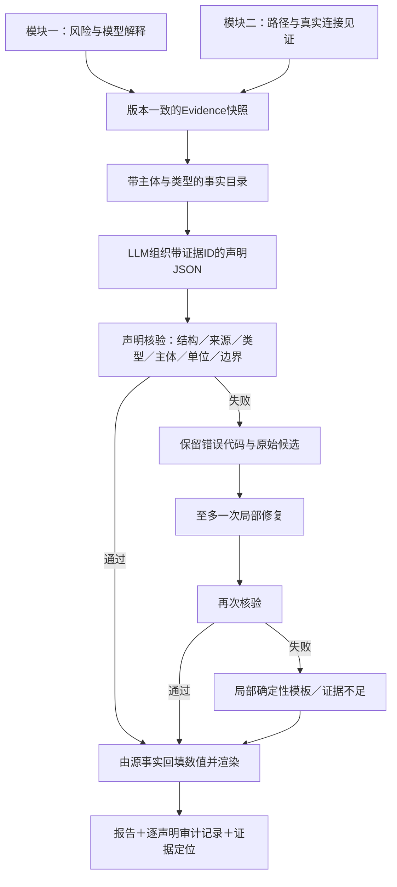

# 模块三设计：证据类型约束的可审计解释报告

历史设计快照：2026-10-12。以下记录设计阶段的目标与诊断；当前实现、验收及边界见[模块三完整记录](MODULE_03_EXPLAINABLE_REPORT.md)。
核心协议、核验、有限修复、定位及针对案例的原CSV索引现已实现；真实LLM API仍未验收。下文“拟/尚未”保留历史设计时状态。
已有能力是Evidence JSON、固定六段JSON报告、字段引用回填、基础校验和模板回退。
本文件是下一阶段开发方案，不把设计目标或故障注入结果表述为已部署性能。

## 1. 核心创新与对应痛点

创新主题：**将报告拆成带类型的声明，用支持该类型的具体证据约束生成、核验与定位。**

研究/应用痛点：LLM可能编造数字、地址、时间、金额或身份；引用了一个真实字段也可能解释错；读者难以从一句报告找到支持它的具体位置。
项目适配是把模块一的模型证据、模块二的路径见证转换为可定位事实，再对每条报告声明核对来源、主体、类型、单位与边界。

三个模块的分工保持一致：

| 模块 | 回答的问题 | 给后续模块的产物 |
|---|---|---|
| 一：地址风险评分 | 地址风险多少、模型依据是什么 | 校准评分、实际联合模型TreeSHAP、图统计、版本 |
| 二：资金关系追踪 | 哪些真实下游关联值得核查 | 原始评分、路径、桥接见证、预算、稳定证据ID |
| 三：可解释报告 | 如何准确说明这些结果并定位依据 | 结构化声明、引用、核验/修复记录、可审核报告 |

模块三不重算风险，不修改路径，也不引入未知真实身份或金额时间信息。四个展示亮点共同支撑一个核心创新，不另拆成四个系统创新。

## 2. 现有实现有哪些缺口

已检查[llm_reporter.py](../src/report/llm_reporter.py)。当前要求固定六个字符串字段，数字/地址使用`{{e:字段路径}}`，校验引用存在和少量禁止词，再将值回填。

在[现有校验诊断](../artifacts/experiments/report_v3_planning/validator_diagnosis.json)中构造10个样例：2个正确样例通过；8个故障样例中2个拦截、6个漏过。

| 注入的错误 | 当前结果 | 需要新增的约束 |
|---|---|---|
| 无来源的阿拉伯数字 | 拦截 | 保留数值来源校验 |
| 引用不存在字段 | 拦截 | 保留路径与可用性校验 |
| 路径排序分冒充地址风险 | 漏过 | 声明类型与事实类型匹配 |
| 用中文编造一百枚比特币 | 漏过 | 缺少金额证据时禁止金额事实类型 |
| 编造昨日/今日资金连续转移 | 漏过 | 时间和资金流能力边界 |
| 编造实际控制者身份 | 漏过 | 身份事实必须有来源，当前禁用 |
| 换一种说法认定洗钱行为 | 漏过 | 禁止法律结论，不依赖几个关键词 |
| 把评分版本字符串当成风险 | 漏过 | 语义类型、单位与主体约束 |

这些是人为故障注入，不是自然LLM输出样本，不能报告为实际幻觉率或线上准确率。
当前引用能证明“值来自某字段”，不能证明“这句话正确解释了那个字段”。

## 3. 四个能让评委听懂的亮点

| 亮点 | 通俗讲法 | 拟实现的机制 | 如何验证 |
|---|---|---|---|
| 输入输出都有结构 | 模型先交一份可检查的说明单，再生成报告 | 事实目录、声明JSON Schema、固定六段渲染 | Schema通过率、字段保真、信息保留 |
| 每句话能找到证据 | 点击一句报告，定位到具体评分、特征或路径段 | 声明ID→事实ID→JSON Pointer/图中位置 | 主体/下标/字段定位正确率 |
| 引用对了，含义也要对 | 不能拿路径分当风险，也不能拿关系图当金额流 | 类型、主体、单位、来源版本与能力约束 | 语义错配拒绝率、正确表述误拒率 |
| 错误只修错误部分 | 一句有问题，保留其余已通过说明 | 有限修复轮次、逐声明复验、局部模板回退 | 修复成功率、正确内容保留、耗时/调用数 |

主讲句：**每条报告声明都有对应证据；系统检查证据是否支持这类表述，再把读者带回具体评分、特征或路径位置。**

## 4. 系统结构



核验范围必须明确：严格默认模式用受约束声明类型与确定性事实句，核验的是受支持的报告协议。
开放式自由分析如后续加入NLI/LLM审核，属于额外语义筛查，不能声称能证明任意自然语言正确。

## 5. 输入：固定快照和带类型事实目录

保留当前Evidence接口，新字段作为兼容扩展。拟增加`schema_version`、`report_id`、`evidence_hash`和`fact_catalog`。

事实目录需要包含：

- `fact_id`：稳定事实标识，绑定数据/评分/追踪版本及定位位置。
- `fact_type`：模型地址风险、联合模型归因、图统计、关系路径、桥接理由或搜索边界。
- `subject`：具体地址、特征组/特征、路径ID、路径内节点/边位置。
- `value`与`unit`：由源Evidence读取，区分0–100地址分、路径排序效用、计数和归因margin。
- `source_pointer`：RFC 6901 JSON Pointer，如`/risk_analysis/overall_score`。
- `source_artifact`：数据指纹、风险/追踪版本、产物路径及定位键。
- `capabilities`：仅支持模型预测/图关系，不具备金额流、真实身份或法律结论能力。
- `display_locator`：地址风险卡、特征表行、路径ID与跳数/边段。

字段类型由程序注册，不让LLM自行声明或修改。元数据字符串不能注册为地址风险事实。
数组引用限定合法非负下标，Pointer转义与类型规则统一验证；不存在、空值或来源错配转为证据不足。

示意（协议设计，尚未接入生产）：

```json
{
  "fact_id": "E_RISK_TARGET",
  "fact_type": "address_model_risk",
  "subject": {"kind": "address", "role": "target"},
  "source_pointer": "/risk_analysis/overall_score",
  "unit": "score_0_100",
  "capabilities": ["model_prediction"],
  "display_locator": {"view": "address_risk", "field": "overall_score"}
}
```

模块一的SHAP记录要注明解释的是联合模型原始输出，避免将贡献解释成因果或犯罪证据。
模块二的31个低分节点完整连接段应保留所有见证边；报告可概括长链，但证据抽屉与下载快照保留完整32跳。

## 6. 输出：声明JSON，再由程序回填事实

LLM输出六个section下的声明数组，声明包含`claim_id`、`claim_type`、`fact_ids`和受限表述选项。
数值与地址由渲染器从事实目录回填，输出JSON不接受LLM重新写一份事实值。
LLM主要选择相关证据、组织顺序和说明结构；事实句使用经核验的渲染规则。

```json
{
  "schema_version": "report_claims_v1",
  "sections": [
    {
      "section": "overview",
      "claims": [
        {
          "claim_id": "C_OVERVIEW_RISK",
          "claim_type": "address_model_risk",
          "fact_ids": ["E_RISK_TARGET"],
          "wording": "model_prediction_only"
        }
      ]
    }
  ]
}
```

生产协议必须校验六段齐全；上面只展示一个section以说明声明结构。
关系路径声明需要路径事实，桥接解释需要真实桥接见证，复核建议使用允许的建议类别；不能以任意一个事实ID支持任意句子。
格式通过不等于内容正确；此协议需要下节的类型与来源规则共同约束。

## 7. 核验分层与局部修复

| 核验层 | 检查什么 | 典型错误代码 |
|---|---|---|
| 结构 | 六段、声明类型、长度、唯一ID、列表字段 | `SCHEMA_INVALID` |
| 引用与来源 | ID存在、指向可用值、来源版本/快照一致 | `REFERENCE_MISSING`、`SOURCE_MISMATCH` |
| 语义类型 | 地址风险只用地址风险事实，路径效用不可冒充风险 | `CLAIM_FACT_TYPE_MISMATCH` |
| 主体与位置 | 目标地址、路径内地址、特征和跳数一致 | `SUBJECT_MISMATCH`、`PATH_POSITION_MISMATCH` |
| 单位与派生 | 比例/分数/计数不混淆；派生数程序计算并记录输入 | `UNIT_MISMATCH`、`DERIVATION_UNSUPPORTED` |
| 能力边界 | 当前缺金额、逐笔时间、身份来源，不生成相关事实声明 | `CAPABILITY_UNAVAILABLE`、`UNSUPPORTED_CONCLUSION` |

不靠关键词黑名单穷举所有幻觉。严格默认模式不允许LLM绕过声明协议插入未审计事实段；不合法字段和自由事实文本拒绝。
如需要自由解释段，必须单独标为候选并设独立语义审核/回退，不能继承严格事实句的通过标志。

修复流程拟为：逐条保留已通过声明，将错误代码、允许的事实ID和失败声明发回同一生成接口，至多重试一次；再失败则对该声明用源事实模板或证据不足替代。
不允许通过修复修改源Evidence、提高风险分或补出原数据没有的证据。结构整体损坏时整篇模板回退仍保留。
每次保留原始候选、错误、修复结果和最终选择；不把模型自我检查等同于客观正确。

## 8. 精确证据定位到什么程度

建议分三层交付，明确已有来源与新增索引的边界：

1. **报告→Evidence具体字段**：点击`[E07]`打开对应JSON Pointer、原值、主体、版本和声明状态。这是第一阶段必须完成的最小闭环。
2. **Evidence→业务具体位置**：特征证据定位到地址/特征表行；路径证据选择对应path_id并高亮具体跳/有向边。32跳也能逐段展开。
3. **业务证据→原始数据记录**：补充离线来源索引，记录原始CSV文件、记录序号、地址/边键和处理策略。当前预处理没有统一保存这些原始记录定位信息，不能直接宣称已支持原始CSV行回溯。

原始CSV定位要处理重复地址的latest_timestep选择、缺失值、边去重与过滤；派生特征同时记录计算参数和上游来源，不能伪造一个“原始值行号”。
CSV记录序号与物理文本行号可能不同，`line_number`未实际追踪时保持空。现有Actors关系缺少完整交易哈希、金额与时间，不制造这些定位字段。

证据位置由程序生成且限制在允许产物内，不让LLM创建任意文件路径/URL。
快照哈希用于核对本地版本与一致性，不能称为数字签名、不可篡改存证或司法取证链。

## 9. 可演示的前后对照

使用明确标注的“故障注入演示”，保留注入文本，不能伪装成自然LLM现场幻觉：

- 注入“该地址风险为路径排序分”：展示类型核验失败、修复为真实地址风险及正确来源。
- 注入“一百枚比特币昨日转出”：展示金额/时间证据不可用，改成真实地址关系描述或证据不足。
- 点击默认样例的桥接说明：定位16.10分节点及通向61.02分节点的真实边段。
- 点击32跳说明：展开完整路径原始风险、路径ID、引用与搜索预算，不将中等风险终点说成高风险。
- 注入一句错误、保留若干正确句：展示局部修复前后，验证正确证据没有丢失。

质量面板展示“声明总数、通过/修复/回退数、未定位引用数、协议事实覆盖率”，不伪造“报告可信概率”。
引用覆盖率高也可能引用错，需与支持正确性、类型拒绝率、信息保留和误拒率一起展示。

## 10. 实验怎么证明减少幻觉

拟比较四个层级：A直接自由生成；B现有六段引用校验；C声明类型与事实渲染；D C加局部修复。
固定Evidence、生成模型、温度与调用预算，修复调用与token/延迟单列；不要用不相等成本宣称全面更优。

| 数据/任务 | 目的 | 指标 |
|---|---|---|
| 手工正确声明＋故障注入 | 确定性合同/类型安全 | 故障拒绝率、正确声明误拒率 |
| 真实Evidence的LLM生成 | 观察自然输出支持情况 | 数字/地址保真、引用支持正确率、无支持声明率 |
| 主体/路径/单位错配 | 检查真引用假含义 | 类型和位置错配拒绝率 |
| 32跳与缺失证据 | 验证长报告、边界和缺失处理 | 路径信息保留、定位正确率、证据不足正确处理 |
| 同候选修复前后 | 验证局部修复的价值 | 错误修复率、正确内容保留、回退率、开销 |

先在开发用例确定规则，冻结后使用另外的模板变体与真实地址报告验证；测试不仅用和规则完全同形的句子。
严格渲染器和自由生成的表达空间不同，要同步评价可读性、所需事实覆盖与人工标注，不能只以零自由文本错误判定全面优越。
NLI/LLM judge可作为辅助，领域含义仍需核对，不能把生成模型自己的判定当唯一真值。
现阶段真实LLM API未配置/未验收，只有当前校验器诊断结果；不填写“幻觉下降XX%”等未测指标。

## 11. 顶会参考与轻量适配

| 论文 | 已核实来源 | 拟借鉴内容 | 项目适配边界 |
|---|---|---|---|
| Enabling Large Language Models to Generate Text with Citations（ALCE） | EMNLP 2023，[官方页](https://aclanthology.org/2023.emnlp-main.398/)，DOI `10.18653/v1/2023.emnlp-main.398` | 评价事实正确性与引用支持，不能只看有无引用 | 引用对象改为固定Evidence事实，增加地址/路径/单位类型；不声称复现其benchmark |
| RARR: Researching and Revising What Language Models Say, Using Language Models | ACL 2023，[官方页](https://aclanthology.org/2023.acl-long.910/)，DOI `10.18653/v1/2023.acl-long.910` | 检查依据后修订，尽量保留已有有效内容 | 使用封闭Evidence和规则错误反馈做局部修复，不外搜补造链上事实；不声称完整复现RARR |

本轮核对Crossref及ACL Anthology元数据并读取两篇官方摘要；文献与来源检查范围保存在[文献元数据](../artifacts/experiments/report_v3_planning/literature_metadata.json)。完整论文机制与实现细节还需在开发阶段进一步阅读，引用数未取得时为null，不猜测。
贡献应表述为面向AML证据的轻量适配与闭环验证，保留论文出处，不把已有方法改名后称完全原创。

## 12. 建议开发顺序与目录

| 阶段 | 拟交付 | 验收 |
|---|---|---|
| P1 | 事实目录、声明Schema、JSON Pointer解析 | 类型、单位、主体与版本测试 |
| P2 | 核验器、确定性渲染、兼容模板 | 错配/缺失拦截，正确信息保留 |
| P3 | 报告到字段/特征/路径点击定位 | 默认及32跳例的准确定位 |
| P4 | 有限局部修复、原始候选与审计文件 | 修复后复验、失败回退、预算计数 |
| P5 | 真实API及对照实验 | 独立统计自然输出/注入用例，完整对照 |
| P6 | 原始CSV来源索引 | 重复、过滤、去重、派生来源可核对 |

拟增加`src/report/fact_catalog.py`、`claim_schema.py`、`claim_validator.py`、`claim_renderer.py`、`report_audit.py`；继续使用现有`llm_reporter.py`入口，不新增独立Agent系统。
参数拟放`config/reporting.yaml`：修复次数、声明长度、最大事实数、严格模式和审核开关，不散落硬编码。
产物拟按`artifacts/reports/{report_id}/`保存`evidence.json`、`claims_raw.json`、`claims_validated.json`、`audit.json`、`report.md`，并保持旧调用方兼容。

当前已完成诊断脚本[29_plan_evidence_reporting.py](../scripts/29_plan_evidence_reporting.py)。本轮未修改评分、追踪或生产报告行为。
