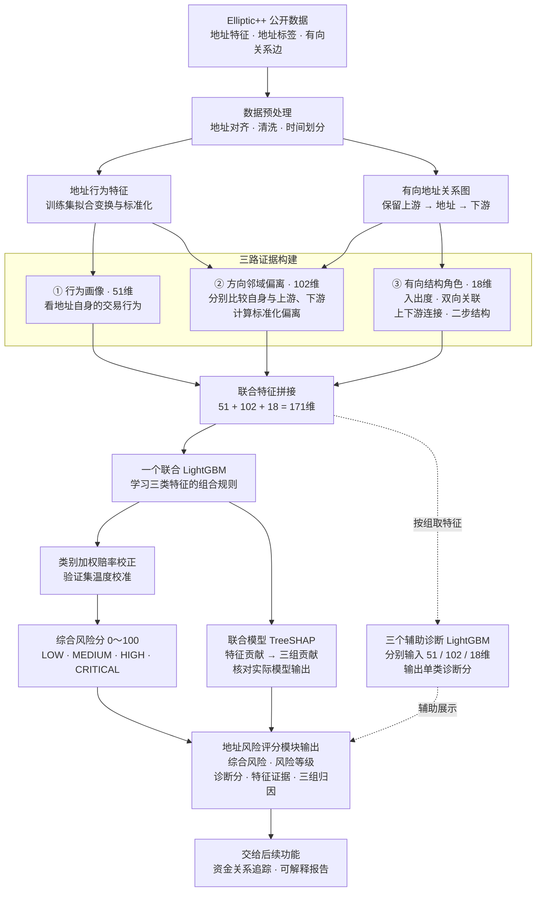

# 地址风险评分模块：三路证据融合结构图

当前版本 V2.0。三路指三个特征证据通道：行为画像、方向邻域偏离、有向结构角色。
综合评分采用一个联合 LightGBM。单组诊断模型独立训练和校准，诊断分不参与综合分的概率平均。

当前模型共四个：行为诊断 LightGBM（51维）、偏离诊断 LightGBM（102维）、结构诊断 LightGBM（18维）、联合主 LightGBM（171维）。三类特征构建分别用数值处理、邻域统计比较、有向图统计，没有独立神经编码器。完整清单见 [模块一实现记录](MODULE_01_ADDRESS_RISK_SCORING.md)。

## 读图要点

- 三路负责构建不同含义的特征，综合分由联合模型直接学习；三路共享部分原始数据。
- 实线表示综合评分与解释主流程；虚线表示辅助诊断，不表示投票或概率平均。
- 标签用于监督训练和评估；unknown 不作为正常标签，也不进入监督损失。在线特征、解释与追踪不读取真实标签。
- TreeSHAP 解释联合树的原始 margin；风险分还需经过类别权重校正与温度校准。贡献不表示现实因果关系。
- 风险等级边界为 30 / 60 / 80，与验证选择的分类阈值用途不同。
- 三路是第一个功能内部的证据通道；整个系统仍是风险评分、关系追踪、可解释报告三个功能。

实验、公式、论文参考与适用边界见 [风险评分重构说明](RISK_SCORING_REDESIGN.md)。
